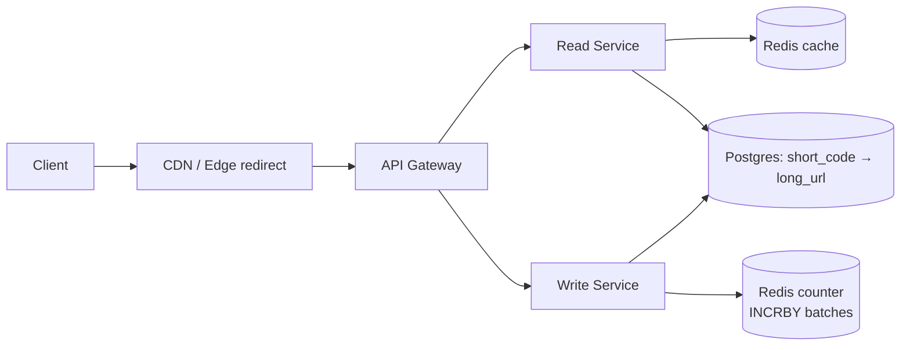

# 01 · Bitly (URL Shortener): Study Notes

**Difficulty:** Easy · **Pattern:** Scaling Reads · **Source:** https://www.hellointerview.com/learn/system-design/problem-breakdowns/bitly
*My own summary of the Hello Interview breakdown. Read the original for diagrams and full detail.*

## Requirements
**Functional (in scope)**
- Turn a long URL into a short one
- Optional custom alias
- Optional expiration date
- Short URL redirects to the original

**Out of scope:** user accounts and auth, click analytics.

**Non-functional**
- Each short code maps to exactly one long URL
- Redirect latency under 100ms
- 99.99% availability; availability is favored over consistency
- Scale: 1B URLs, 100M daily active users
- Very read-heavy, roughly 1000 reads for every write. This one fact drives most of the design.

## Core entities
Original URL, Short URL, User.

## API
- `POST /urls {long_url, custom_alias?, expiration_date?}` → `{short_url}`
- `GET /{short_code}` → 302 redirect to the long URL (410 Gone if expired)

## High-level design
- **Components:** client, primary server, database (short_code → long_url, alias, expiry).
- **Create flow:**
  1. Validate the URL.
  2. Use the custom alias if it's free; otherwise generate a code.
  3. Insert the mapping and return the short URL.
- **Dedup is optional.** Most shorteners allow several codes per long URL so each can have its own expiry or analytics.
- **Keep custom aliases from colliding with generated codes,** for example with a reserved prefix or separate namespaces.
- **Redirect flow:**
  1. Look up the code.
  2. Check expiry.
  3. Send the redirect.
- **301 vs 302:**
  - 301 is cached by browsers, so later visits skip your server.
  - 302 is not cached, so you keep control: you can change or expire links and count clicks. **Prefer 302.**
- **Cleanup:** a periodic job removes expired rows, and the cache TTL should be no longer than the link's expiry.

## Deep dives
### 1. Unique short codes
| Option | Verdict | Notes |
|---|---|---|
| Prefix of the long URL | Bad | Any two URLs that start the same collide |
| Hash (e.g., SHA-256) → base62 → first N chars | Great | Deterministic. 8 chars gives about 218T codes. Collisions grow with fill (chance ≈ n/\|S\|), so add a UNIQUE constraint and retry 3–5 times with a salt. Use HMAC or a salt if codes shouldn't be guessable. |
| Global counter → base62 | Great | No collisions. Redis `INCR` is atomic because Redis is single-threaded. 1B URLs is only 6 chars ("15ftgG"); 7 chars covers about 3.5T. Downside: codes are predictable, so XOR with a secret before encoding if that matters. |

Base62 is base64 without `+` and `/`, because those characters break URLs.

### 2. Fast redirects
- **Index** (good): make short_code the primary key, which gives a B-tree with O(log n) lookups.
- **The numbers:** 100M users × 5 redirects a day is about 5.8k per second on average, or about 600k per second at a 100x peak. That's too much for one database.
- **Redis/Memcached, cache-aside** (great):
  - Memory is about 100ns, SSD about 0.1ms, HDD about 10ms.
  - Use LRU eviction and expect a warm-up period.
- **CDN + edge functions** (great): Cloudflare Workers or Lambda@Edge can redirect hot codes at the edge without touching the origin. The cost is complexity and money, and invalidation is harder.

### 3. Scale to 1B URLs and 100M users
- **Storage:** about 500 bytes per row × 1B rows ≈ 500GB, which fits on one Postgres instance.
- **Write rate:** about 100k new URLs a day, roughly 1 per second, so any database works.
- **Availability:** replication plus backups.
- **Split services:** a read service for redirects and a write service for creates, each scaled horizontally on its own.
- **Shared counter:**
  - Keep it in a central Redis.
  - **Counter batching:** each writer claims 1000 IDs at once with INCRBY 1000, which means fewer round trips.
  - Use Sentinel or Cluster for failover.
  - Give each region its own counter range so regions don't have to coordinate.
  - Losing a few IDs in a failover is fine, since codes only need to be unique, not continuous. The database's UNIQUE constraint is the final safety net.

## Final architecture (in words)
Client → (CDN/edge) → API gateway → Read service ↔ Redis cache ↔ DB, and Write service ↔ Redis counter → DB (Postgres, replicated).

## Level expectations
- **Mid:** a working design, a reasonable way to generate unique codes, an index, and a cache once prompted.
- **Senior:** drives the discussion; compares hashing and counters, covers caching and invalidation, splits reads and writes, and scales the counter.
- **Staff:** brings up multi-region counter ranges, Redis failover, the security of guessable codes, alias collisions, and cleanup without being asked.

## Key takeaways
- A lopsided read/write ratio means caching first, then CDN/edge.
- Choosing how to generate unique IDs (hash vs counter vs Snowflake) comes up again and again.
- Batching cuts coordination cost.

## Discussion highlights (comments)
- Some readers argue for 301 when analytics really is out of scope. The counterpoint: you'd lose control of links already cached in browsers.
- Alternatives to a Redis counter: a Postgres SEQUENCE, Snowflake IDs (longer codes, about 11 chars), or ZooKeeper-leased ID ranges.

## Architecture diagram (my own drawing)

