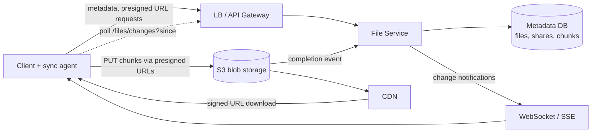

# 02 · Dropbox (File Storage & Sync): Study Notes

**Difficulty:** Easy · **Pattern:** Handling Large Blobs · **Source:** https://www.hellointerview.com/learn/system-design/problem-breakdowns/dropbox
*My own summary of the Hello Interview breakdown. Read the original for diagrams and full detail.*

## Requirements
**Functional:** upload from any device, download from any device, share files and see files shared with you, sync automatically across devices.
**Out of scope:** editing files, previewing without downloading.

**Non-functional**
- Availability over consistency. A few seconds of delay before another user sees a file is fine; compare that with stock trading, where it isn't.
- Files up to 50GB
- Secure and durable; lost or corrupted files can be recovered
- Upload, download and sync as fast as possible

**Out of scope:** per-user quotas, versioning, virus scanning.

## Core entities
File (the raw bytes), FileMetadata (name, size, MIME type, owner, status), User.

## API (how it evolved)
- **Upload:** `POST /files/presigned-url {metadata}` → presigned URL. The client then PUTs straight to S3, and an S3 event notification marks the file "uploaded".
- **Download:** `GET /files/{id}/presigned-url` → a signed CDN or S3 URL.
- **Share:** `POST /files/{id}/share {users[]}`
- **Sync:** `GET /files/changes?since=ts` → ChangeEvent[] (fileId, type, metadata)
- **Security:** identify the user from the session or JWT, never from a userId in the request.

## High-level design
- **Metadata database:** DynamoDB or Postgres; either works.
- **Where the bytes go:**
  - Bad: on one server's disk.
  - Good: through the backend into S3, which means uploading twice.
  - **Great: straight to S3 with presigned URLs.** Status goes "uploading" → "uploaded" when the S3 notification arrives.
- **Download:**
  - Bad: proxy the file through the server.
  - Good: an S3 presigned URL.
  - **Great: a signed CDN URL.** CDNs are expensive, so use Cache-Control and invalidation to cache only popular files.
- **Sharing:**
  - Bad: a sharelist array on each file. Finding files shared with me means scanning everything.
  - Good: an inverse cache of user → [files], updated in the same transaction.
  - **Great: a normalized SharedFiles table** with PK userId and SK fileId.
- **Sync:**
  - **Local → remote:** a client agent watches the folder (FSEvents, FileSystemWatcher), queues changes and uploads them. Conflicts are last-write-wins.
  - **Remote → local, hybrid:**
    - One WebSocket or SSE connection per device pushes changes as they happen.
    - Periodic polling of `/changes?since` acts as a safety net in case a push is missed.

## Deep dives
### 1. Large files (the core of the interview)
- **Why a single POST fails:**
  - Timeouts: 50GB at 100Mbps takes about 1.1 hours.
  - Payload limits: API Gateway caps requests at 10MB.
  - A dropped connection means starting over.
  - No progress bar.
- **Chunk on the client, never on the server,** into 5–10MB pieces. That gives progress bars and resumable, parallel uploads.
- **Track chunk state in metadata:** `chunks: [{id, status}]`.
- **Keeping chunk state honest:**
  - Good: the client PATCHes the status. Risky, since a malicious client can lie.
  - **Great: trust but verify.** The client sends ETags and the server checks them with S3 ListParts.
- **Fingerprints:**
  - SHA-256 of the whole file handles dedup and "can this be resumed?".
  - Per-chunk hashes show which parts are already done.
  - fileId stays a UUID; the fingerprint is a separate field.
- **S3 multipart flow:**
  1. CreateMultipartUpload → uploadId.
  2. A presigned URL per part.
  3. Upload the parts.
  4. PATCH each part's ETag.
  5. CompleteMultipartUpload → the file becomes "uploaded".
  - S3 notifications only fire once the whole object is complete, not per part.
- **Downloads don't need chunking.** HTTP Range requests give parallel or resumable downloads.

### 2. Speed
- CDN for downloads; parallel, adaptive chunks for uploads.
- **Delta sync:** only upload the chunks that changed.
- **Content-Defined Chunking:** use a rolling (Rabin) hash so inserting one byte doesn't shift every later chunk boundary.
- **Compression on the client:**
  - Worth it for text; skip it for media, which barely shrinks.
  - Zstd, Brotli or Gzip.
  - Always compress before encrypting.

### 3. Security
- HTTPS in transit and S3 encryption at rest.
- The share table is the access control list.
- **Short-lived signed URLs (about 5 minutes):**
  - They're bearer tokens, so anyone holding one can download until it expires.
  - Add IP binding or cookies for stricter control.
- **CloudFront signed URLs:** signed with a private key and checked at the edge with the public key.

## Final architecture (in words)
Clients (uploader/downloader) → LB/API gateway → File Service (metadata + presigned URLs, the control plane only) ↔ Metadata DB (files + shares). Bytes go client ↔ S3 directly, and downloads go through the CDN. Sync uses a WebSocket notifier plus polling.

## Level expectations
- **Mid:** a working upload, download and share design, and can reason through "you're uploading twice" when prompted.
- **Senior:** moves fast to the large-file deep dive and knows multipart upload.
- **Staff:** depth on chunking, verification, CDC and security; steers the conversation as a peer.

## Key takeaways
- Keep app servers out of the data path: presigned URLs plus a CDN.
- Large files need client-side chunking, fingerprints and resumable state.
- For sync, push in real time and poll as a backstop.

## Architecture diagram (my own drawing)

