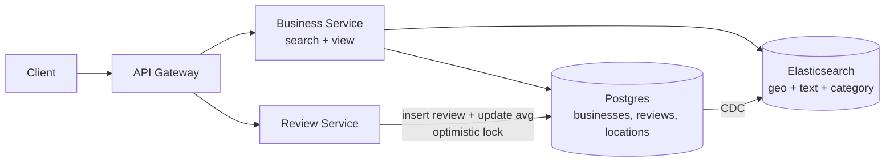

# 03 · Yelp (Local Business Reviews): Study Notes

**Difficulty:** Easy · **Patterns:** Scaling Reads, Proximity Search · **Source:** https://www.hellointerview.com/learn/system-design/problem-breakdowns/yelp
*My own summary of the Hello Interview breakdown. Read the original for diagrams and full detail.*

## Requirements
**Functional:** search businesses by name, location (lat/long) and category; view a business and its reviews; leave a review (1–5 stars required, text optional).
**Out of scope:** admin CRUD, map view, recommendations.

**Non-functional**
- Search latency under 500ms
- High availability; eventual consistency is fine
- Scale: 100M daily users, 10M businesses

**Extra constraint the interviewer adds:** one review per user per business.

## Core entities
Business (name, location, category, average rating), User, Review (rating, text).

## API
- `GET /businesses?query&location&category&page` → Business[], paginated
- `GET /businesses/:id` and `GET /businesses/:id/reviews?page`
- `POST /businesses/:id/reviews {rating, text?}`

## High-level design
- **Path:** Client → API Gateway → Business Service (search and view) → DB.
- **Separate Review Service,** because reviews are written rarely while search and view are read constantly. The services scale differently.
- **One shared database is fine.**
  - Size: 10M businesses × 100 reviews ≈ 1TB, which fits on one instance.
  - Businesses and reviews are tightly coupled.
  - Fault isolation can come from replication.
  - "Not every microservice needs its own DB": prefer simplicity.

## Deep dives
### 1. Average rating in search results
| Option | Verdict | Notes |
|---|---|---|
| JOIN + AVG on every query | Bad | Expensive and recomputes for nothing |
| Cron job precomputes the average | Good | Stale for hours |
| **Update on each write + optimistic locking** | Great | Store `num_reviews`. new_avg = (old×n + r)/(n+1). Only write if num_reviews hasn't changed (version check); otherwise retry. |

**A message queue is overkill.**
- At about 1000:1 reads to writes, 100M users produce roughly 100k reviews a day, about 1 write per second.
- Saying so is a staff-level signal: "simplicity shows seniority".

**Race example:**
- Two reviewers both read n=100, avg=4.0.
- Each computes a new average and writes it.
- The second write silently overwrites the first. That lost update is what optimistic locking prevents.

### 2. One review per user per business
- Bad: check in the application. Other writers, such as backfills or other services, skip the check, and there's a race.
- **Great: a database UNIQUE constraint on (user_id, business_id).** Enforce constraints as close to storage as possible.

### 3. Efficient complex search (the heart of the interview)
- **Lat/long range queries combined with `LIKE '%coffee%'`** mean a full table scan.
- **A B-tree on (lat, long)** (bad): B-trees can't do 2-D range queries efficiently.
- **Each filter needs its own index:**
  - Location → geospatial index (geohash, quadtree or R-tree)
  - Name → inverted index (full-text)
  - Category → B-tree
- **Elasticsearch** (great):
  - One bool query covers all three: match + geo_distance + term.
  - Never use it as the primary database.
  - Keep it in sync with **CDC**: DB changes → stream → consumer → ES.
- **Postgres + PostGIS + pg_trgm** (great): no sync problem, and the data is small (about 10GB of businesses).
- **If Elasticsearch isn't allowed, talk about:**
  - Geohash vs quadtree. Prefer a quadtree here because updates are rare and businesses cluster densely in cities.
  - A second filtering pass using the **Haversine** distance.
  - Ordering: apply the most selective filter (location) first.

### 4. Search by place names ("Pizza in NYC", "The Mission")
- A radius isn't enough because neighborhoods are irregular **polygons**, often stored as GeoJSON.
- Add a `locations` table (name, type, polygon) with an index on name.
- Query with Elasticsearch geo_shape or PostGIS.
- **Better: precompute at write time.**
  - Store `location_names: ["bay_area","san_francisco","mission_district"]` on each business.
  - Use a keyword (inverted) index on that field, so there's no polygon math per request.

## Final architecture (in words)
Client → API Gateway → Business Service and Review Service → Postgres (businesses, reviews, locations). Postgres → CDC → Elasticsearch for search, or Postgres with PostGIS only.

## Key takeaways
- Spatial search needs spatial indexes: geohash, quadtree, R-tree.
- Precompute aggregates (averages, area tags) at write time when writes are rare.
- Enforce data constraints in the database.
- Use optimistic locking for concurrent counters.

## Architecture diagram (my own drawing)

