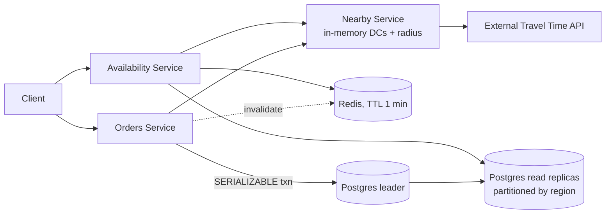

# 04 · Local Delivery Service (Gopuff): Study Notes

**Difficulty:** Easy · **Patterns:** Scaling Reads, Dealing with Contention · **Source:** https://www.hellointerview.com/learn/system-design/problem-breakdowns/gopuff
*My own summary of the Hello Interview breakdown. Read the original for diagrams and full detail.*

## Requirements
**Functional**
- Check which items can be delivered within 1 hour of a location. Availability is the union of stock across all nearby distribution centers (DCs).
- Order several items at once.

**Out of scope:** payments, driver routing, search and catalog, cancellations.

**Non-functional**
- Availability lookups under 100ms, fast enough to power search
- Ordering is **strongly consistent**: no two customers can buy the same physical unit
- Scale: 10k DCs, 100k catalog items, about 10M orders a day

## Core entities
- **Item:** a product type, like "Cheetos". Think of it as the class.
- **Inventory:** a physical unit sitting in a specific DC. Think of it as the instance.
- **DistributionCenter:** a location with lat/long.
- **Order:** a set of inventory units plus shipping info.

The Item vs Inventory split is the key modeling insight.

## API
- `GET /availability?lat&long&keyword&page` → items with quantities
- `POST /orders {lat, long, items[]}`. Location is needed again to confirm a nearby DC can deliver.

## High-level design
- **Availability flow:**
  1. Availability Service → Nearby Service finds the DCs that can deliver in time.
  2. Query Inventory joined with Items for those DC IDs.
  3. Sum per item and return.
- **Catalog vs inventory:** ideally separate them and give the catalog a search index. Here they share one database for simplicity.
- **Orders without double-selling:**
  - Good: separate order and inventory stores with a distributed lock.
    - A crash between steps leaves things inconsistent, so you need sweepers.
    - Overlapping orders can deadlock: one holds the lock on A, the other on B.
  - **Great: a single Postgres transaction at SERIALIZABLE isolation.**
    1. Check stock for every item.
    2. Mark the inventory "ordered".
    3. Insert Order and OrderItems rows.
    4. Commit.
    - All or nothing: if any item is missing the whole order fails, with a clear error.
    - Trade-off: inventory and orders now scale together.
  - Principle: when you need atomicity, keep the data together in one ACID store.
- **Topology:**
  - Three services: Availability, Orders, and a shared Nearby service.
  - One Postgres database, partitioned by region.
  - Reads go to replicas; orders go to the leader.

## Deep dives
### 1. Real drive time, not straight-line distance
- **Plain SQL distance** (bad), whether Euclidean or Haversine: ignores rivers, borders and traffic.
- **Travel-time API against every DC** (bad): far too many calls.
- **Great:**
  - Cache the DC list in memory, refreshed every 5 minutes (buildings rarely change).
  - Narrow to DCs within about 60 miles, the most you could drive in an hour.
  - Call the external travel-time service only for those candidates.

### 2. Fast, scalable availability
- **Estimate:** 10M orders a day ÷ 100k seconds × 10 page views per purchase ÷ 5% conversion ≈ **20k queries per second**.
- **Redis cache-aside with a ~1 minute TTL:** the Order Service invalidates affected keys whenever it writes inventory.
- **Partition by region:**
  - Region = first 3 digits of the zip code, so a query touches only 1–2 partitions.
  - Read replicas serve availability, since slightly stale reads are fine.
  - The leader handles orders.

## Final architecture (in words)
Client → Availability Service (Redis, then Postgres read replicas) and Orders Service (Postgres leader, serializable transactions). Both call the Nearby Service (in-memory DCs + radius filter + external Travel Time Service). Postgres is partitioned by region.

## Key takeaways
- Reads and writes get different consistency: eventually consistent availability, strongly consistent orders.
- Filter cheaply first, then call the expensive service (radius, then travel-time API).
- Estimate QPS from the business metric (orders a day) to justify caching.
- Avoid distributed transactions by keeping data that must change together in one place.

## Architecture diagram (my own drawing)

