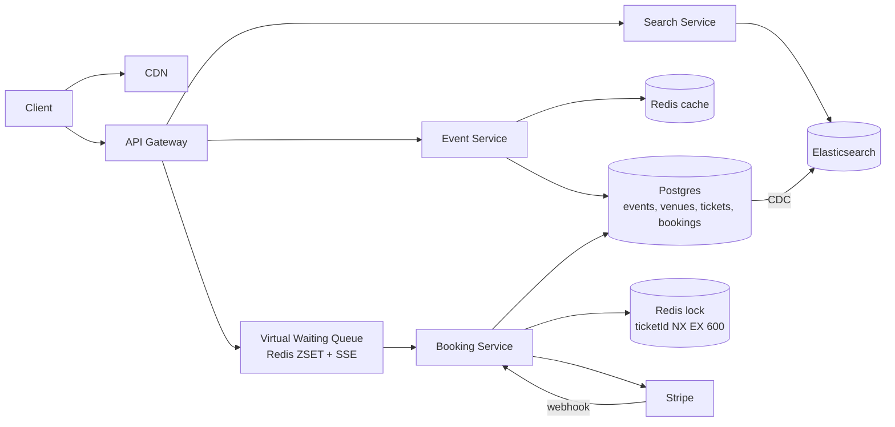

# 05 · Ticketmaster (Ticket Booking): Study Notes

**Difficulty:** Medium · **Patterns:** Dealing with Contention, Scaling Reads, Real-time Updates · **Source:** https://www.hellointerview.com/learn/system-design/problem-breakdowns/ticketmaster
*My own summary of the Hello Interview breakdown. Read the original for diagrams and full detail.*

## Requirements
**Functional:** view events (with the seat map), search events, book tickets.
**Out of scope:** viewing my bookings, admin event creation, dynamic pricing.

**Non-functional**
- **Mixed CAP:** availability for viewing and search, **consistency for booking** (no double booking)
- Popular events see huge spikes, like 10M users on one event
- Search under 500ms
- Read-heavy, about 100:1

## Core entities
- **Event, User, Performer**
- **Venue:** includes the seat map, stored as JSON or a table of sections, rows and seats
- **Ticket:** one per seat, created when the event is created. Holds eventId, seat, price and status.
- **Booking:** groups a user's tickets with a total price and status.

## API
- `GET /events/:id` → Event + Venue + Performer + Ticket[], used to render the seat map
- `GET /events/search?keyword&start&end&page`
- `POST /bookings/:eventId {ticketIds, paymentDetails}`. This later splits into **reserve** and **confirm**.

## High-level design
- **Services:** API Gateway (auth, rate limiting) → Event Service, Search Service, Booking Service, all on one Postgres. Sharing a database is fine because the data is tightly coupled and booking needs ACID.
- **Booking v1:** a single transaction checks availability, marks the tickets booked and inserts the booking. Stripe handles payment.
- **The flaw:** a user can fill in payment details only to find the seat already gone.

## Deep dives
### 1. Reserving tickets during checkout (the core)
| Option | Verdict | Notes |
|---|---|---|
| Long `SELECT FOR UPDATE` held for about 5 minutes | Bad | Database locks are meant to last milliseconds. Long ones cause contention and deadlocks, and crashes leave locks orphaned. |
| status + expires_at, cleared by cron | Good | Seats stay unavailable until the cron runs, and the cron is a single point of failure |
| **Implicit status:** a ticket is free if AVAILABLE or (RESERVED and expired) | Great | A short transaction reserves for now+10 minutes. Needs a compound index. A sweep keeps the table tidy, but correctness doesn't depend on it. |
| **Redis distributed lock with TTL** | Great | `SET ticketId userId NX EX 600` is atomic. The database then only needs AVAILABLE/BOOKED. Multi-seat holds: lock each seat and roll back on failure, or use a Lua script. |

**Redis lock details:**
- **Showing reserved seats on the map:**
  - A plain Redis Set leaves "ghost" holds behind when locks expire.
  - Use a **sorted set scored by expiry time** (`ZADD event:{id}:reserved <expiresAt> ticketId`) and count only scores in the future.
  - Trim old entries with ZREMRANGEBYSCORE.
- **If Redis goes down:** the experience degrades, but there is still no double booking, because OCC or row locks in the database are the real guard.
- **If the TTL expires mid-payment:** the database transaction fails for one of the two users, who gets an automatic refund. Extend the lock when payment starts.

**Final booking flow:**
1. Pick a seat → `POST /bookings`.
2. Take the Redis lock with a 10-minute TTL.
3. Insert the booking as "in-progress" and return its bookingId.
4. The card is tokenized with Stripe.js, so the server never sees card numbers (PCI).
5. A PaymentIntent is created and Stripe confirms through a webhook.
6. The webhook transaction marks the ticket "sold" and the booking "confirmed".
   - The webhook must be **idempotent**, using bookingId as the key, because Stripe retries.

### 2. Scaling views to tens of millions of requests
- **Cache heavily:** event, venue and performer data is static. Cache it as `eventId → object` in Redis.
- **Invalidation:** database triggers plus TTLs (long for venues, short for availability).
- **Infrastructure:** load balancing with round robin or least-connections, and a stateless Event Service that scales horizontally.

### 3. User experience under massive demand
- **Good:** SSE pushes seat changes live. In a "Taylor Swift" sale, though, the map empties instantly and it's chaotic.
- **Great: a virtual waiting queue,** which an admin turns on per event.
  - Users join a Redis sorted set ordered by timestamp.
  - SSE pushes each user's position and estimated wait.
  - Users are let in in batches and added to `admitted:{eventId}` with a TTL.
  - The Booking Service rejects anyone not admitted.
- **Staff-level insight:** the best fix is often a product change, not harder technology.

### 4. Low-latency search
- `LIKE '%Taylor%'` means a full scan.
- Good: B-tree indexes and query tuning (EXPLAIN, no SELECT *, UNION instead of OR). Still poor for partial matches.
- Great: database full-text search (Postgres tsvector + GIN).
- Great: **Elasticsearch** (inverted index, fuzzy matching for "Tayler Swift"), kept in sync with **CDC** from Postgres.

### 5. Caching repeated searches
- Good: Redis keyed on every search parameter, with a TTL. Cache tags make invalidation easier.
- Great: Elasticsearch's own query and request caches, plus a **CDN for non-personalized results**.

## Architecture diagram (my own drawing)

## Key takeaways
- Contention pattern: hold seats with short leases (TTL locks or implicit expiry). Never hold a long database lock.
- Two layers of protection: Redis for the experience, database OCC for correctness.
- Make webhooks idempotent.
- A waiting room is a product answer to an overwhelming spike.

## Game-design hooks
- Countdown-timer reservation mechanic.
- Queue-position progress UI.
- A "race for scarce seats" contention puzzle.
