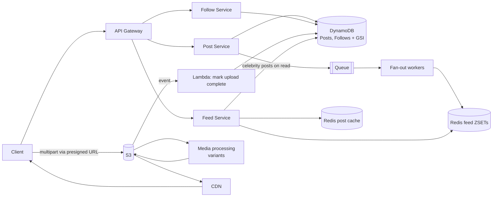

# 06 · Instagram (Photo Sharing): Study Notes

**Difficulty:** Medium · **Patterns:** Scaling Reads, Handling Large Blobs, Managing Long Running Tasks · **Source:** https://www.hellointerview.com/learn/system-design/problem-breakdowns/instagram
*My own summary of the Hello Interview breakdown. Read the original for diagrams and full detail.*

## Requirements
**Functional:** create posts (photo or video plus caption), follow users, see a chronological feed of the people you follow.
**Out of scope:** likes and comments, search, stories, live video.

**Non-functional** (scale: 500M daily users, 100M posts a day)
- Availability over consistency; up to 2 minutes of eventual consistency is fine
- Feed in under 500ms end to end
- Media renders instantly (photos up to 8MB, videos up to 4GB)
- Scales to 500M daily users

## Core entities
- **User**
- **Post:** one entity covers both photo and video
- **Media:** the bytes, in S3
- **Follow:** a one-way follower → followee relationship

## API
- `POST /posts {caption, media meta}` → postId plus a presigned upload URL
- `POST /follows {followedId}`. The follower comes from the JWT.
- `GET /feed?cursor&limit` → Post[] + next_cursor

## High-level design
- **Services:** API Gateway → Post Service (Posts DB + S3) and Follow Service (Follows table).
  - Sharing one database across services is a valid choice; the trade-offs are spelled out.
- **Database: DynamoDB.** Postgres also works; Instagram itself runs Postgres.
  - Follows table: PK followerId, SK followedId.
  - Posts table: PK userId, SK createdAt#postId.
- **Feed v1 (fan-out on read):**
  1. Get my followees.
  2. Query each one's recent posts.
  3. Merge, sort and paginate.

## Deep dives
### 1. Feed under 500ms
- **Why fan-out on read breaks:**
  - 1000 followees means 1000+ queries (DynamoDB batches cap at 100 items).
  - The same popular posts get re-read constantly.
  - Latency varies wildly from user to user.
  - About 2.5B feed builds a day, or 150k+ per second at peak.
- **Bad:** cache `feed:{user}:{cursor}`. It treats the symptom, and the cache has to be huge.
- **Good: fan-out on write.**
  1. A new post goes onto a queue.
  2. The Feed Fan-out workers look up followers through a GSI (PK followedId).
  3. They push the postId into each follower's Redis ZSET `feed:{userId}`, scored by timestamp.
  - **Hydration, hybrid:** postIds come from the ZSET, metadata from a short-TTL Redis HASH cache, and misses go to DynamoDB BatchGetItem.
  - **Problem:** the **celebrity problem**. One post from a star means millions of writes.
- **Great: a hybrid.**
  - Accounts with fewer than ~100k followers fan out on write.
  - Celebrities fan out on read: their posts are merged in when the feed is requested.
  - The threshold needs tuning, and people who follow many celebrities get slower feeds.
  - Instagram does something similar in production.
- **Redis durability:** mention Sentinel failover, Cluster sharding, and AOF or RDB persistence.

### 2. Instant media (8MB photos, 4GB videos)
- **Upload:**
  - The presigned URL plus S3 multipart upload sends chunks directly to S3.
  - The post's status goes pending → complete.
  - Prefer **server-driven completion** (an S3 event triggers a Lambda that updates metadata) over the client sending a PATCH.
- **Serving:**
  - Bad: straight from S3. High latency far from the region, costly, and one size for every device.
  - Good: a CDN (CloudFront) with edge caching for about 24 hours.
  - **Great: CDN plus dynamic media optimization.**
    - Generate variants (resolutions, WebP; adaptive bitrate for video) with a tool like Cloudinary or Imgix.
    - Serve the right variant for each device and network.
    - Pre-warm caches for viral content.

### 3. Scaling to 500M daily users
- **Media:** about 2MB × 100M posts = 200TB a day, or about 750PB over 10 years. Move cold media to Glacier.
- **Metadata:** about 100GB a day. Move cold rows to S3.
- **Storage tiers:** CDN → memory → SSD → HDD → tape; move cold data down a level to save money.
- **Compute:** stateless services auto-scale on CPU or memory behind load balancers.

## Architecture diagram (my own drawing)

## Key takeaways
- The classic trade-off: fan-out on read vs fan-out on write, and the hybrid that handles celebrities.
- Feed = list of IDs + a separate hydration step.
- Media path: presigned upload → multipart → processing variants → CDN.

## Game-design hooks
- A "celebrity post" event that floods the system.
- A threshold-tuning slider puzzle.
- Storage-tier cost management.
