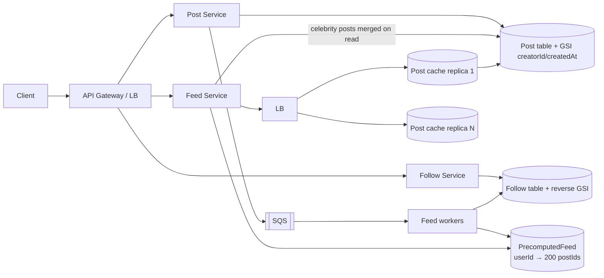

# 07 · Facebook News Feed: Study Notes

**Difficulty:** Medium · **Pattern:** Scaling Reads (fan-out) · **Source:** https://www.hellointerview.com/learn/system-design/problem-breakdowns/fb-news-feed
*My own summary of the Hello Interview breakdown. Read the original for diagrams and full detail.*

## Requirements
**Functional:** create posts, follow people (one-way), view a reverse-chronological feed, page through it.
**Out of scope:** likes and comments, privacy and visibility.

**Non-functional**
- Availability over consistency; up to **1 minute** of staleness is OK
- Posting and feed reads under 500ms
- 2B users
- **No limit** on follows or followers, which is where the fan-out problem comes from

## Core entities
User, Follow (a one-way link), Post.

## API
- `POST /posts {content}` → postId
- `PUT /users/:id/follow`. PUT makes it idempotent; unfollow would be DELETE.
- `GET /feed?pageSize&cursor=<timestamp>` → items + nextCursor. The cursor is the oldest timestamp seen so far.

## High-level design
- **Post Service:** stateless and horizontally scaled behind the API gateway, writing to **DynamoDB**.
- **Follow graph in a key-value store (no Neo4j needed):**
  - Table PK userFollowing, SK userFollowed.
  - A GSI on the reverse (PK userFollowed) finds a user's followers.
  - This supports: "does A follow B?", "who does A follow?", and "who follows B?".
- **Feed Service**, separate because its read pattern is different.
  - Posts GSI: PK creatorId, SK createdAt.
  - Naive flow: followees → their posts older than the cursor → merge and sort.
- **Interview tip:** say out loud that this won't scale, finish the breadth first, then go deep.

## Deep dives
### 1. Users who follow many accounts (fan-out on read is too slow)
- **Product lever:** cap the number of follows (Facebook caps friends at 5000) or accept a slightly delayed feed for extreme users.
- **PrecomputedFeed table:**
  - userId → the latest ~200 postIds, newest first.
  - Storage: 10 bytes × 200 = 2KB per user; × 2B users ≈ **4TB**. Cheap.
  - Fall back to the naive query if someone scrolls past 200.
- **Cost gut check:** a fraction of a cent per user, against about $100 a year in revenue per user.

### 2. Accounts with huge followings (fan-out on write is too heavy)
- **Bad:** blast every write from the Post Service. Too many connections, and the load is badly uneven across hosts.
- **Good:** an SQS queue with at-least-once delivery and a fleet of async feed workers.
  - Problem: some jobs are enormous (1M followers vs 1k), so split large jobs into chunks.
- **Great: async workers plus hybrid feeds.**
  - Flag celebrity follows as "not precomputed".
  - At read time, merge the precomputed feed with recent posts from those celebrities.
  - The choice is made **per account**: "no one-size-fits-all solution".

### 3. Uneven reads (viral posts are hot keys)
- DynamoDB needs load spread evenly across keys; viral posts break that.
- **Good:** a sharded Redis post cache with long TTL and LRU, invalidated on edit.
  - Problem: the shard holding a viral post becomes the hot spot.
- **Great: a redundant (replicated) post cache.**
  - N independent instances behind a load balancer, each able to serve any post.
  - A hot post gets N times the throughput with no coordination.
  - Cost: up to N cache misses per post, and fewer distinct posts fit overall.

## Architecture diagram (my own drawing)

## Key takeaways
- Fan-out on read vs write, mixed per account.
- Caches for hot keys: replicate them rather than shard them.
- Product limits (follow caps) are a legitimate design tool.
- A timestamp cursor gives you infinite scroll.

## Game-design hooks
- A "viral post" hot-key event.
- A choice between a sharded and a replicated cache.
- A feed-pipeline puzzle where you pick read-time vs write-time work for each account.
