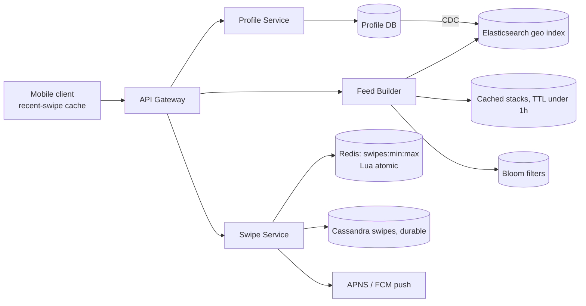

# 08 · Tinder (Dating / Swipe App): Study Notes

**Difficulty:** Medium · **Patterns:** Dealing with Contention, Proximity Search, Scaling Writes · **Source:** https://www.hellointerview.com/learn/system-design/problem-breakdowns/tinder
*My own summary of the Hello Interview breakdown. Read the original for diagrams and full detail.*

## Requirements
**Functional**
- Create a profile with preferences (age range, interests, maximum distance)
- View a stack of candidates that fit those preferences and are within range
- Swipe yes or no
- Get a match notification when both people swipe yes

**Out of scope:** photos, chat, premium features such as super swipes.

**Non-functional**
- **Strong consistency for swipes:** a mutual yes must always produce a match
- 20M daily users × ~100 swipes each, about 2B swipes a day
- The stack loads in under 300ms
- Never re-show a profile the user has already swiped on

## Core entities
User (who is also the profile being swiped on), Swipe (from, to, decision), Match.

## API
- `POST /profile {age_min, age_max, distance, interestedIn}`
- `GET /feed?lat&long&distance` → User[]. No pagination: these are recommendations, so the app just asks again when it runs out.
- `POST /swipe/{targetUserId} {decision}`. The person swiping comes from the JWT.

## High-level design
- **Profile Service + Profile DB:** handles preferences and the naive feed query (age, gender and lat/long ranges). That query is slow.
- **Separate Swipe Service + Swipe DB (Cassandra):**
  - Swipes are written constantly: about 200GB a day at ~100 bytes each.
  - Cassandra is write-optimized (CommitLog → Memtable → SSTables), partitioned by swiping_user_id.
  - The cost is eventual consistency.
- **Swipe flow:** save the swipe → look for the reverse swipe → if there's a match, show "It's a match!" to B and send A a push through APNS or FCM.

## Deep dives
### 1. Consistent, low-latency swipes
- **The race:**
  1. A and B swipe yes at the same moment.
  2. Each request checks for the other's swipe and finds nothing.
  3. Both swipes are saved and nobody is told about the match.
- **Alternative trade-off:** a periodic reconciliation job that finds missed matches and notifies both people. This gives up consistency for availability.

| Option | Verdict | Notes |
|---|---|---|
| Poll the database for matches | Bad | Not instant, so no dopamine hit, and it adds load |
| Transactions | Good | Cassandra's lightweight transactions (Paxos) only work within one partition, but swipes are spread across partitions |
| **Cassandra keyed on the user pair** | Great | Partition key = `min(id):max(id)`, so A→B and B→A share a partition and one batch can write and check atomically. Watch for partition growth and hot users; needs a cleanup or archive plan. |
| **Redis + Lua** | Great | Key `swipes:{min}:{max}`, a hash of both users' swipes. A Lua script does HSET and HGET atomically. Consistent hashing keeps a pair on one node. Cassandra stays the durable store and Redis data can expire aggressively. |

### 2. Low-latency stack generation
- **Good: an indexed search database** (Elasticsearch or OpenSearch with geo indexes), kept in sync with CDC and writing in batches.
- **Good: precompute and cache** stacks in background jobs. Very active users run through them quickly.
- **Great: a hybrid.**
  - Serve a cached stack immediately.
  - Query the index in real time once it runs low.
  - Prefetch when only a few profiles are left, so the stack feels endless.
- **Stale feeds:** candidates move or change their profiles.
  - Use a TTL under 1 hour.
  - Only precompute for recently active users.
  - Refresh when the user changes filters or moves far.
  - TTL, stack size and the target group are all **tunable parameters**.

### 3. Never re-show swiped profiles
- Bad: fetch the swipe history from the database and do a contains check. Replicas may lag, and histories get big.
- **Great: a client-side cache** of the last K swipes, used to filter new stacks. The client is part of the system, which works because one person uses one device.
- **Great: a Bloom filter** for users with huge histories.
  - It can return false positives (a few profiles are never shown) but never false negatives (no repeats).
  - The error rate is tunable against memory.
  - It has to be rebuilt if the cache is lost.

## Architecture diagram (my own drawing)

## Key takeaways
- Put both sides of an interaction on the same key or partition (sorted pair key) so you can update atomically without distributed transactions.
- Cache plus real-time fallback for recommendations.
- The client can hold state too.
- Bloom filters answer "already seen?" cheaply.

## Game-design hooks
- A "mutual swipe race" condition puzzle.
- A Bloom filter mini-game that trades false-positive rate against memory.
- An "infinite stack" prefetch-timing mechanic.
