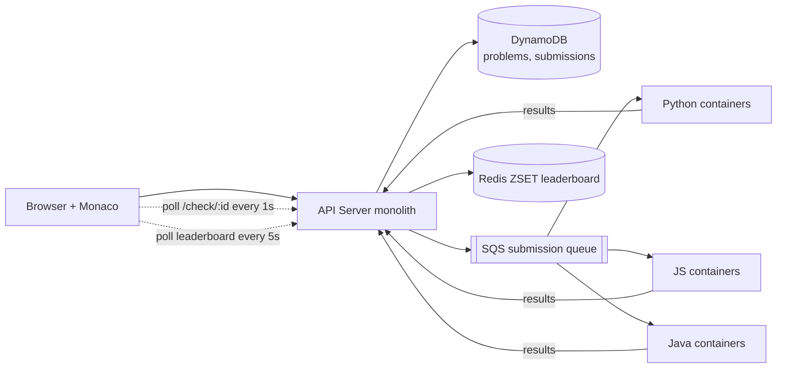

# 09 · LeetCode (Online Coding Judge): Study Notes

**Difficulty:** Medium · **Pattern:** Managing Long Running Tasks · **Source:** https://www.hellointerview.com/learn/system-design/problem-breakdowns/leetcode
*My own summary of the Hello Interview breakdown. Read the original for diagrams and full detail.*

## Requirements
**Functional**
- Browse the list of problems
- View a problem and code a solution in several languages
- Submit and get feedback right away
- Live leaderboard during competitions

**Out of scope:** auth, profiles, payments, analytics, social features.

**Non-functional**
- Availability over consistency
- **Isolated, secure execution of user code**
- Results in under 5 seconds
- Competitions with up to 100k users
- **This is a small system** (a few hundred thousand users, about 4k problems), so keep the design simple.

## Core entities
Problem (statement, code stubs per language, test cases), Submission, Leaderboard.

## API
- `GET /problems?page&limit` → Partial<Problem>[] (title, id, level, tags only)
- `GET /problems/:id?language=` → Problem with the stub for that language
- `POST /problems/:id/submit {code, language}`. Never trust a userId or timestamp sent by the client; the server sets them.
- `GET /leaderboard/:competitionId?page&limit`
- Later added: `GET /check/:submissionId`, polled every second once execution becomes async.

## High-level design
- **A monolith is fine at this scale.** Not everything needs microservices.
- **DynamoDB problem document:** codeStubs per language (an LLM can generate them from one example) and testCases nested inside.
- **Monaco editor** in the browser.

**Where to run user code**

| Option | Verdict | Why |
|---|---|---|
| On the API server | Bad | Security (deleting data, mining crypto, DDoS), CPU hogging, and crashes take down the API |
| Inside a VM | Good | Isolated, but heavy and slow to boot |
| **One container per language** | Great | Light and fast. Containers can be reused. Shares the host kernel, so harden it. |
| Serverless functions | Great | Auto-scaling, but cold starts and resource limits |

- **Chosen: containers.** The worker runs code with Docker exec and reads the output from stdout or a mounted volume.

**Competition rules:** 90 minutes, 10 problems, 100k users. Rank by problems solved, then by solve time.
- **Naive leaderboard:** GROUP BY over submissions (a GSI on competitionId in DynamoDB), polled every 5 seconds. This hammers the database.

## Deep dives
### 1. Isolation and security
- Read-only filesystem, with a temporary output directory.
- CPU and memory limits; the container is killed if it goes over.
- Hard timeout of about 5 seconds to stop infinite loops.
- No network access (VPC security groups and NACLs).
- **seccomp** to restrict system calls.
- In the interview, naming these at a high level is usually enough.

### 2. Efficient leaderboard
- Bad: poll a database query every time.
- Good: a Redis cache rebuilt every 30 seconds.
- **Great: a Redis sorted set plus polling.**
  - `ZADD competition:leaderboard:{id} score userId` on each passing submission.
  - `ZRANGE ... 0 N-1 REV WITHSCORES` to read the top N.
  - Clients poll every 5 seconds and page through results.
- **WebSockets are overkill** here.
  - Staff-level signal: know the complex option and explain why it isn't needed.
  - Progressive polling: faster near the end of the competition.

### 3. Scaling to 100k-user competitions
- **Back-of-envelope:**
  - 10k concurrent submissions × 100 tests × 100ms = 100k CPU-seconds.
  - Finishing in 1 minute would take about 1,667 cores.
- **Vertical scaling** (bad): a single machine can't reach that, and it sits idle the rest of the time.
- **Horizontal auto-scaling** (great): ECS with auto-scaling for each language's containers.
- **Plus an SQS queue** (great):
  - Buffers spikes and gives retries if a container fails.
  - Execution becomes **async**: the client polls `/check/:id` every second, which is what real LeetCode does.
  - Arguably over-engineered, but worth it for retries and peace of mind.

### 4. Running test cases in any language
- Write **one language-agnostic set of test cases** per problem with serialized input and output. For example, trees as level-order arrays: `[3,9,20,null,null,15,7]` → 3.
- **A harness for each language** deserializes the input into native types (TreeNode and so on), calls the user's function and compares the result.

## Architecture diagram (my own drawing)

## Key takeaways
- Sandbox untrusted code: containers, limits, no network, seccomp.
- Async job + polling pattern.
- A Redis sorted set is the standard leaderboard tool.
- Size the design to the real scale and push back on over-engineering.

## Game-design hooks (very relevant to a gamification app)
- Leaderboard ZSET design (score + tie-break time).
- Progressive polling near the end of a match.
- A language-agnostic test-case format for puzzle validation.
- Async submission judging.
