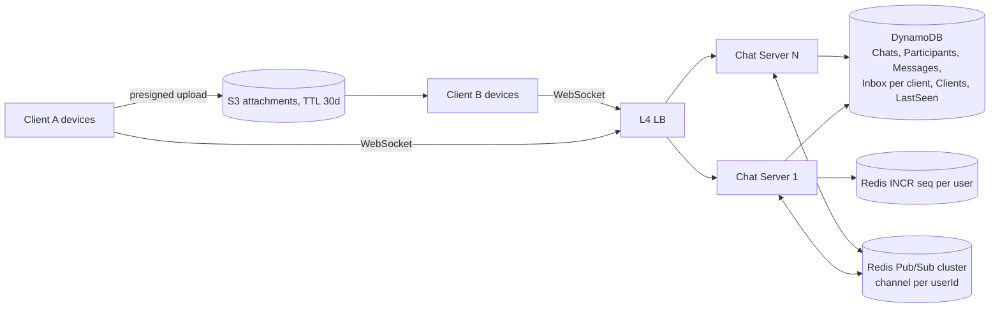

# 10 · WhatsApp (Messaging): Study Notes

**Difficulty:** Medium · **Pattern:** Real-time Updates · **Source:** https://www.hellointerview.com/learn/system-design/problem-breakdowns/whatsapp
*My own summary of the Hello Interview breakdown. Read the original for diagrams and full detail.*

## Requirements
**Functional**
- Group chats with up to 100 participants
- Send and receive messages
- **Offline delivery:** messages sent while you're offline are kept for up to 30 days
- Media attachments

**Out of scope:** calls, business features, registration.

**Non-functional**
- Delivery under 500ms to users who are online
- **Guaranteed delivery**
- Billions of users
- Store messages on servers only as long as needed
- Survives individual component failures

## Core entities
User, Chat (2–100 participants), Message, Client (one user can have several devices).

## API: commands over a WebSocket (TLS)
- **Client → server:** `createChat`, `sendMessage` (returns messageId), `createAttachment` / `getAttachmentTarget`, `modifyChatParticipants`
- **Server → client:** `chatUpdate` and `newMessage`. The client must **ACK** each one; the ACK is what makes delivery guaranteed.

## High-level design
- **L4 load balancer** (no L7 features are needed) → Chat Server → DynamoDB.
  - Chat table: PK chatId.
  - ChatParticipant table: PK chatId, SK participantId, plus a GSI on participantId so you can list a user's chats.
- **Start with a single host:** an in-memory map of userId → socket. Reason on one node first, then scale.
- **Offline delivery with an Inbox:**
  1. Write the message to the Messages table and an Inbox row for each recipient.
  2. Return SUCCESS to the sender.
  3. Push to recipients who are online.
  4. The recipient ACKs, and the Inbox row is deleted.
  - When a user reconnects, drain their Inbox.
  - TTLs clean up old rows.
  - Load: 200M users × 20 messages ≈ 40k messages a second, about 100k writes a second. Fine for DynamoDB.
- **Attachments:**
  - Bad: store them in the database.
  - Good: upload through the chat server to S3 with a 30-day TTL. Wastes the chat server's bandwidth.
  - **Great: presigned upload straight to S3.** The message carries an opaque URL. A CDN helps little with groups capped at 100.

## Deep dives
### 1. Billions of users across many chat servers
- About 200M concurrent connections at 1–2M per host means hundreds of servers. The sender and recipient may be on different hosts.
- **Bad:** a plain load balancer with horizontal scaling. Messages can't be routed to the right host.
- **Bad:** a Kafka topic per user. About 50KB of overhead per topic × 1B users = 50TB+.
- **Good: consistent hashing** of users to servers, with a ZooKeeper or etcd registry.
  - Needs a full mesh between servers.
  - Rebalancing is hard (thundering herd on reconnect).
- **Great: Redis Pub/Sub,** sharded by userId.
  - Each server subscribes to the channels of its connected users.
  - Pub/Sub is at-most-once, so the order matters:
    1. **Write durably first** (Messages + Inbox).
    2. Acknowledge the sender.
    3. Publish as a best-effort fast path.
  - Benchmark: Canva pushed 100k messages a second on one Redis host at 27% load.
- **Per-user vs per-chat channels:**
  - Mostly 1:1 chats, so per-user channels.
  - Adaptive: chats larger than ~25 members also get their own channel (the "celebrity problem").

### 2. Multiple devices
- Add a Clients table.
- The Inbox becomes **per client**, and messages fan out to every device.
- Cap it, e.g. 3 devices per account.

### 3. Dead WebSockets
- Bad: wait for TCP keepalive, which takes minutes.
- Good: ACK timeout + retries, then close the socket. Only catches failures while you're sending.
- **Great: application-level heartbeats.**
  - Ping every 10–30 seconds, pong within 5.
  - Bounded detection time (10 + 5 = 15 seconds).
  - 20M pings a second is acceptable.

### 4. Messages dropped by Pub/Sub
- Good: clients poll for a sync every 30–60 seconds. That's about 7M queries a second.
- Good: per-chat sequence numbers (Redis INCR) with gap detection. Only works when another message arrives.
- **Great: a per-user sequence number piggybacked on heartbeats.**
  - If the client is behind, it syncs right away.
  - Production systems combine heartbeats + sequence numbers + polling as a backstop.

### 5. Out-of-order messages
- Don't enforce strict order.
- Servers stamp messages with the receive time (synced over NTP).
- Clients sort by the server timestamp. A late message occasionally pops in above a newer one, and users accept that.

### 6. "Last seen"
- Bad: write to the database on every heartbeat. Millions of writes a second.
- **Great:**
  - Write a LastSeen row only **on disconnect** (conditional update: only if the timestamp is newer).
  - `getLastSeen` checks the database and also pings the target's channel.
  - If the target's server answers "ONLINE", show the green dot; otherwise show the disconnect time.

## Architecture diagram (my own drawing)

## Key takeaways
- Durable inbox + ACKs give guaranteed delivery; Pub/Sub is only the fast path.
- Heartbeats + sequence numbers detect silent failures.
- Pick routing by channel granularity (user vs chat).
- Write on rare events (disconnects), not frequent ones (heartbeats).

## Game-design hooks
- Real-time multiplayer chat and presence ("last seen" / online dot).
- Heartbeat-based disconnect detection.
- Sequence-gap resync for game-state messages.
