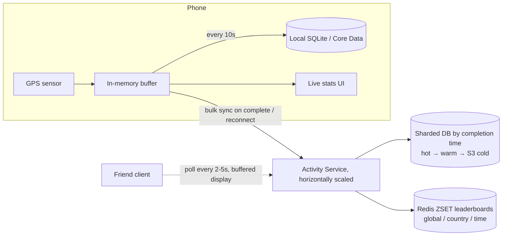

# 11 · Strava (Fitness Tracking): Study Notes

**Difficulty:** Medium · **Patterns:** Scaling Writes, Real-time Updates (and when you don't need them) · **Source:** https://www.hellointerview.com/learn/system-design/problem-breakdowns/strava
*My own summary of the Hello Interview breakdown. Read the original for diagrams and full detail.*

## Requirements
**Functional:** start, pause, stop and save runs or rides; see live route, distance and time during the activity; view your own and friends' completed activities.
**Out of scope:** managing friends, auth, likes and comments.

**Non-functional**
- Availability far above consistency
- **Works offline** in remote areas
- Accurate, live local stats during the activity
- 10M concurrent activities

## Core entities
User, Activity (type, start and end, distance, duration, state), Route (GPS points), Friend.

## API
- `POST /activities {type: RUN|RIDE}`
- `PATCH /activities/:id {state: STARTED|PAUSED|COMPLETE}`. PATCH because it's a partial update; COMPLETE also shares it with friends.
- `POST /activities/:id/routes {location}`. This disappears once tracking moves to the client.
- `GET /activities?mode=USER|FRIENDS&page&pageSize` → Partial<Activity>[]
- `GET /activities/:id`

## High-level design
- **Simple client → Activity Service → DB.**
- **Pause-aware elapsed time:**
  - Keep a **log of (status, timestamp)** events and sum only the active intervals.
  - Example: start → paused at 10 min → resumed at 15 → stopped at 20 gives 15 minutes active.
  - The log also enables "total vs active time" later.
- **GPS:** sample every 2s (ride) or 5s (run) with Core Location or FusedLocationProvider. Distance is Haversine between consecutive points.
- **Friends table:** two rows per friendship (A,B and B,A) with a composite PK.
- **Maps:** draw the route as a polyline with the Google Maps API.

## Deep dives
### 1. Offline tracking (the insight that reshapes the design)
- **Record everything on the device** and sync when the activity ends or the phone is back online.
  - Works with no network.
  - About 100x fewer requests.
  - Live stats are instant because they're computed locally.
- **Buffering:**
  - Keep points in memory.
  - Save to local storage every ~10s (Core Data or Room/SQLite) so a crash loses at most 10s.
  - On restart, reload the buffer.
  - Upload in bulk when the activity completes, chunked for long activities, with background sync.
  - Delete the local copy once the server confirms.
- **The client is an active part of the system,** not just a display.
- **The backend stays a simple monolith,** because the client absorbed most of the write load.

### 2. Scaling to 10M concurrent activities
- **Storage:**
  - 100M activities a day ≈ 36.5B a year.
  - A route is ~600 points × 24 bytes ≈ 15KB.
  - That's about **550TB a year**.
- **Shard by completion time,** since most queries want recent activities.
- **Data tiering:** hot (recent) → warm (3–12 months) → cold (more than a year, S3 archive).
- **Cache** only if reads turn out to be slow.
- **Any mainstream database works.** "It doesn't really matter."

### 3. Friends watching live
- Send updates to the server every 2–5 seconds again.
- **Polling beats WebSockets here:**
  - Updates are predictable (every 2–5s).
  - Near-real-time is good enough.
- **Smart buffering:** deliberately show the athlete 1–2 updates behind, so the movement looks smooth, like a live stream.

### 4. Leaderboard of top athletes
- Bad: SUM and GROUP BY over every activity on each request.
- Good: a nightly aggregate table. Stale.
- **Great: Redis sorted sets.**
  - `ZINCRBY leaderboard:run:global dist user` and `leaderboard:run:USA` for each country or region.
  - **Time-range leaderboards:**
    - A ZSET of activityId scored by timestamp, plus a HASH per activity holding user and distance.
    - Query with ZRANGEBYSCORE for the window, sum per user in memory, sort, and cache with a short TTL.
  - Watch Redis ↔ DB consistency and memory use for every filter combination. Keep only popular boards in Redis.

## Architecture diagram (my own drawing)

## Key takeaways
- Offline-first, client-heavy design is a valid architecture.
- Event logs make time calculations correct.
- Polling with a deliberate display lag gives smooth "live" tracking cheaply.
- Leaderboards with ZINCRBY, plus a time-window design.

## Game-design hooks (fitness/gamification gold)
- Distance leaderboards by region and time window.
- An active-time vs paused-time log for streak or quest validation.
- Offline progress that syncs later.
- A smooth "ghost runner" replay using buffered positions.
