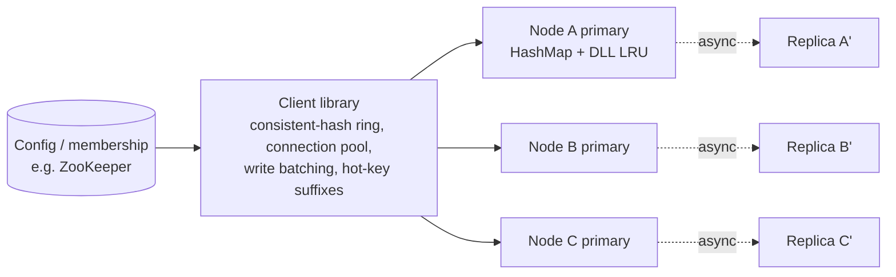

# 12 · Distributed Cache (Redis-like): Study Notes

**Difficulty:** Medium · **Patterns:** Scaling Reads, Consistent Hashing · **Source:** https://www.hellointerview.com/learn/system-design/problem-breakdowns/distributed-cache
*My own summary of the Hello Interview breakdown. Read the original for diagrams and full detail.*

## Requirements
**Functional:** set, get and delete key-value pairs; per-key TTL; LRU eviction. Confirm the eviction policy with the interviewer.
**Out of scope:** configurable cache size.

**Non-functional**
- High availability; eventual consistency is fine
- **Gets and sets under 10ms**
- **1TB of data, 100k requests a second**

**Out of scope:** durability, strong consistency, complex queries, transactions.

**Note:** interviewers ask this question very differently. Some want low-level design or code, others architecture. Go through entities and API quickly.

## Core entities and API
- **Entities:** keys and values.
- **API:** `POST /:key {value}`, `GET /:key`, `DELETE /:key`

## High-level design (low-level-design flavor)
1. **A hash table** gives O(1) get, set and delete.
2. **TTL:**
   - Store `(value, expiry)` and check it lazily on get.
   - A background **janitor** sweeps expired keys, running on a schedule or under memory pressure.
3. **LRU = hash map + doubly linked list,** all operations O(1).
   - Map key → node.
   - Move a node to the head on access.
   - Evict from the tail when over capacity.
   - Dummy head and tail nodes keep the code simple.
   - Example with capacity 2: add A → [A]; add B → [B, A]; add C → evict A → [C, B].

## Deep dives
### 1. High availability (replication)
| Option | Verdict | Notes |
|---|---|---|
| Synchronous replication | Bad (for this cache) | Waits for every replica, so it's slow, and one bad replica blocks writes |
| **Async primary → replicas** | Good | Fast writes, no conflicts because the primary orders writes. Stale replicas, and failover needs promotion. This is Redis's default; WAIT gives semi-sync. |
| **Peer-to-peer gossip** | Good | No single point of failure, scales well. Needs conflict resolution and is more complex. |

What matters in the interview is knowing the trade-offs rather than picking "the" answer.

### 2. Scaling: how many nodes?
- **Throughput:** 100k ÷ 20k per node ≈ 5 nodes, so about 8 with headroom.
- **Memory:**
  - 1TB ÷ ~24GB usable per 32GB host ≈ 43 nodes, so about **50**.
  - Memory decides; provision for the larger number.

### 3. Even key distribution: consistent hashing
- `hash % N` remaps almost every key when N changes.
- **A ring** (with MurmurHash):
  - A key goes to the next node clockwise.
  - Adding or removing a node only moves the keys in that node's range.

### 4. Hot reads
- Bad: scale every node up vertically. Wasteful.
- Good: a dedicated hot-key tier. Promotion and demotion logic is complex.
- Good: read replicas of whole nodes. Heavy.
- **Great: copy just the hot key.**
  - Store `user:123#1..#N` on different nodes.
  - Readers pick a random suffix; writes update every copy (eventually consistent).
  - Example: 100k reads a second ÷ 4 copies = 25k each.
  - Only good for keys that are read-heavy.

### 5. Hot writes
- **Write batching:**
  - The client buffers writes for 50–100ms and sends one combined update, e.g. +1000 views.
  - Trade-off: a delay before writes are visible, and buffered writes can be lost on failure.
- **Split the key with suffixes:**
  - `views:video123:1..10`; each write picks a random shard.
  - Reads sum all shards: faster writes, slower reads.

### 6. Performance across the network
- Batch requests.
- Client-side consistent hashing, so there's no routing hop.
- **Connection pooling** cuts handshakes and p99 latency.

## Architecture diagram (my own drawing)

## Key takeaways
- LRU = hash map + doubly linked list. This is a must-know coding answer.
- Size the cluster from both memory and throughput; the larger number wins.
- Hot read → replicate the key; hot write → split or batch the key.

## Game-design hooks
- An LRU-eviction puzzle level ("which item gets evicted?").
- A consistent-hashing ring visual where adding or removing a node shows which keys move.
- A hot-key "viral" event.
