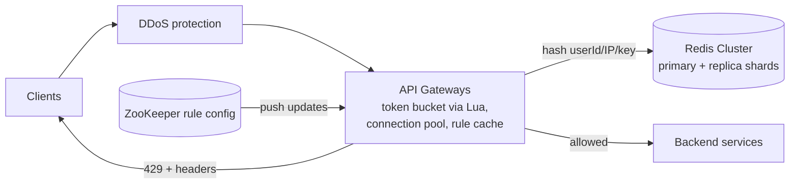

# 13 · Distributed Rate Limiter: Study Notes

**Difficulty:** Medium · **Patterns:** Dealing with Contention, Scaling Writes · **Source:** https://www.hellointerview.com/learn/system-design/problem-breakdowns/distributed-rate-limiter
*My own summary of the Hello Interview breakdown. Read the original for diagrams and full detail.*

## Requirements
**Functional**
- Identify clients by user ID, IP or API key
- Limit requests with configurable rules, e.g. 100 a minute per user
- Reject with **429** plus helpful headers (limit, remaining, reset)

**Out of scope:** analytics, long-term persistence.

**Non-functional**
- Under **10ms** of added latency per check
- High availability; eventual consistency across nodes is fine
- **1M requests a second, 100M daily users**

## Core entities and interface
- **Rules:** limit, window, scope and endpoint
- **Clients:** user, IP or key
- **Requests**
- **Interface:** `isRequestAllowed(clientId, ruleId) → {passes, remaining, resetTime}`

## High-level design
### Where the limiter lives
- **In-process** (bad): each server only sees its own slice of the traffic. With N servers, the real limit is off by up to N times.
- **Dedicated service** (good): has global state and richer context, but adds a network hop and another point of failure (fail open or closed?).
- **API gateway / load balancer** (great): blocks at the door like a bouncer, so backends never see rejected traffic.
  - It only has request-level context, so premium tiers have to be encoded in the JWT.

### Identifying clients
- User ID from the JWT, IP from X-Forwarded-For (watch out for NAT), API key from X-API-Key.
- **Layer the rules** (per user, per IP, global, per endpoint) and enforce the **strictest one that applies**.

### Algorithms
| Algorithm | How it works | Pros | Cons |
|---|---|---|---|
| Fixed window counter | One counter per minute bucket | Very simple | Bursts at the boundary (200 requests in 2 seconds), starvation |
| Sliding window log | Keep every timestamp, drop the old ones | Exact | Lots of memory and CPU |
| Sliding window counter | Weighted previous window + current window (e.g. 70% of last + 100% of current) | Two counters, good accuracy | Assumes traffic is even within a window |
| **Token bucket** ✅ | Capacity = allowed burst, refills at a steady rate; each request spends a token | Handles bursts, little state (tokens, last_refill) | Choosing size and rate; cold start |

**Chosen: token bucket in Redis**, the approach Stripe uses.
- Store `HMGET user:bucket tokens last_refill`, refill based on elapsed time, decrement, and `EXPIRE` after an hour idle.
- **Race condition:** reading outside MULTI/EXEC lets two gateways spend the same token. **Fix: one Lua script** that reads, computes and writes atomically.

### Responding when over the limit
- **Fail fast with 429** rather than queuing (queues cost memory, trigger retries, and make latency unpredictable).
- Headers: `X-RateLimit-Limit`, `X-RateLimit-Remaining`, `X-RateLimit-Reset`, `Retry-After`.

## Deep dives
### 1. 1M requests a second
- One Redis does about 100–200k ops a second, or roughly 50–100k checks.
- **Shard with consistent hashing** on the client identifier, so each client lives on exactly one shard. About 10 shards.
- In production, use **Redis Cluster** (16,384 hash slots, automatic routing).

### 2. High availability
- **Fail-closed vs fail-open:** both are "good"; it depends on the system.
  - Fail-closed suits payments and security, and was chosen for the social platform here: limiter failures tend to happen during traffic spikes, and failing open could cascade into a full outage.
  - Fail-open keeps things available but loses protection.
- **Prevent failures with master-replica pairs and automatic failover** (Redis Cluster).
- Monitor Redis health and alert when entering fail mode.

### 3. Latency
- **Connection pooling** avoids 20–50ms handshakes.
- **Deploy in each region** near users; eventual consistency across regions is OK.
- Other options: local caching (risky), pipelining or Lua, batching.

### 4. Hot keys
- **Legitimate heavy users:** client-side rate limiting in SDKs, batch APIs, premium tiers.
- **Abuse:** automatic blocklisting after repeated violations, plus DDoS protection (Cloudflare, AWS Shield).
- Set higher IP limits to allow for shared NATs.

### 5. Changing rules at runtime
- Good: gateways poll a config database every ~30 seconds. Simple, but changes are delayed.
- Great: push through **ZooKeeper watches** or Redis pub/sub for near-instant updates. Handles partial failures, but adds complexity.

## Architecture diagram (my own drawing)

## Key takeaways
- Know all four algorithms; the token bucket is the usual pick.
- Make read-modify-write atomic (Lua).
- Shard by client key.
- Choose fail-open vs fail-closed deliberately for the system.

## Game-design hooks
- An "energy / stamina" system is literally a token bucket (capacity + refill rate).
- Anti-cheat action throttling.
- Configurable per-tier limits (free vs premium players).
