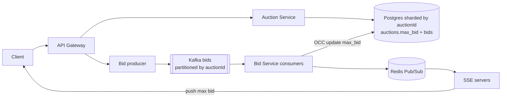

# 14 · Online Auction (eBay): Study Notes

**Difficulty:** Medium · **Patterns:** Dealing with Contention, Real-time Updates · **Source:** https://www.hellointerview.com/learn/system-design/problem-breakdowns/online-auction
*My own summary of the Hello Interview breakdown. Read the original for diagrams and full detail.*

## Requirements
**Functional:** list an item with a starting price and end date; bid (accepted only if higher than the current highest); view an auction with its current highest bid.
**Out of scope:** search, filters, sorting, history UI.

**Non-functional**
- **Strong consistency for bids:** everyone sees the same highest bid
- **Durable:** never lose a bid
- Highest bid shown in real time
- 10M concurrent auctions

## Core entities
- Auction (starting price, end date, max bid)
- Item, normalized so it can be relisted, edited separately, and searched later
- Bid
- User

## API
- `POST /auctions {item, startDate, endDate, startingPrice}`
- `POST /auctions/:id/bids {bid}`
- `GET /auctions/:id`

## High-level design
- **Auction Service:** CRUD. Images go in blob storage and are referenced by URL.
- **Separate Bidding Service:** about 100x more bids than auctions, complex logic, and tuned for writes.
- **Keep a full bids table** (accepted and rejected) rather than overwriting a maxBid field. **Never destroy history**; it's the audit trail for disputes.
- **v1 viewing:** poll the max bid every few seconds.

## Deep dives
### 1. Strong consistency for bids
- **The race:**
  1. A reads $10 and bids $100.
  2. B reads a stale $10 and bids $20.
  3. Both bids are accepted.
- **Staff-level counterargument:** order doesn't matter much, since the highest bid wins in the end. You could reconcile on the client. Most interviewers still want consistency.

| Option | Verdict | Notes |
|---|---|---|
| `SELECT ... FOR UPDATE` on every bid row, then MAX | Bad | **Doesn't stop new inserts** (phantoms). Locks a growing number of rows. Slow. |
| Max bid in Redis with a Lua compare-and-set | Good | Atomic in Redis, but Redis and the database can disagree (no two-phase commit). Options: Redis as the source of truth with async DB writes, or write DB first then invalidate. |
| **Max bid on the auction row in the database** | Great | Lock **one row, briefly**, or use **OCC**: `UPDATE auctions SET max_bid=:new WHERE id=:id AND max_bid=:old`, retrying on conflict. Conflicts are rare, so OCC fits. |

**Principle:** if you need atomicity across systems, restructure so the data lives in one system.

### 2. Durability
- Get bids into **Kafka** right away, so the bid survives even if the service crashes.
- Kafka also buffers end-of-auction surges.
- **Partition by auctionId:** bids for one auction are processed in order (fair tie-breaks), and different auctions run in parallel.
- Adds about 2–10ms of latency. The consumer processes bids at its own pace, with retries.

### 3. Real-time highest bid
- **Good: long polling** (30–60s timeout). The server holds requests and answers them all when a bid lands. Thundering herd on reconnect.
- **Great: SSE.**
  - The server keeps a map of auctionId → open connections and pushes new max bids.
  - It only needs one direction, so it's lighter than WebSockets.
  - Problem: viewers of the same auction are spread across servers.

### 4. Scaling to 10M concurrent auctions
- **Throughput:**
  - 10M auctions × 100 bids ÷ 7 days ≈ 140M bids a day ≈ 1.4k a second.
  - Peak is about 10x: **~15k a second**.
- **Kafka:** a modest number of partitions keyed by auctionId.
- **Services:** stateless and auto-scaled.
- **Storage:**
  - 520M auctions a year × (1KB + 100 × 0.5KB) ≈ 25TB a year.
  - **Shard Postgres by auctionId** for write throughput. No scatter-gather, since one auction lives on one shard.
- **SSE fan-out across servers:** Redis Pub/Sub or Kafka. Every bid server subscribes and forwards to its own local viewers. (See FB Live Comments.)

### Extra follow-ups
- **Extending the end time** ("ends an hour after the last bid"):
  - Simple: update end_time on each bid and let a cron close auctions.
  - Precise: schedule a delayed task (Redis ZSET, a job queue, or Step Functions) and check whether that bid is still the latest when it fires.
- **Purchasing:** email the winner; if they don't pay in time, move to the next-highest bidder.
- **Bid history in real time:** the same SSE mechanism.

## Architecture diagram (my own drawing)

## Key takeaways
- Keep the contended value on a single row and use OCC.
- Put a durable queue in front of writes you can't lose.
- Kafka partitioning gives ordering within an entity.
- SSE + Pub/Sub delivers real-time updates at scale.

## Game-design hooks
- Live bidding wars with a countdown that extends after each late bid.
- An "outbid!" push notification.
- Fairness puzzle: two bids for the same amount at the same moment.
