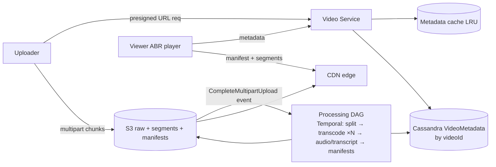

# 15 · YouTube (Video Upload & Streaming): Study Notes

**Difficulty:** Medium · **Patterns:** Handling Large Blobs, Scaling Reads, Managing Long Running Tasks · **Source:** https://www.hellointerview.com/learn/system-design/problem-breakdowns/youtube
*My own summary of the Hello Interview breakdown. Read the original for diagrams and full detail.*

## Requirements
**Functional:** upload videos; watch (stream) videos.
**Out of scope:** view counts, search, comments, recommendations, channels, subscriptions.

**Non-functional**
- Availability over consistency
- Videos of tens of GB
- **Low-latency streaming even on poor bandwidth**
- 1M uploads and 100M views a day
- **Resumable uploads**

With only two features, the non-functional requirements are what make this problem hard.

## Core entities
User, Video, VideoMetadata (uploader, URLs to the manifest and transcripts, chunk status).

## API (evolved)
- `POST /presigned_url {metadata}` → URL for a direct multipart upload to S3
- `GET /videos/{id}` → VideoMetadata, including the manifest URL

## Streaming background (worth knowing)
- **Codec:** compresses video (H.264, H.265, VP9, AV1). Trades encode time, device support, efficiency and quality.
- **Container:** the file format holding video, audio and metadata.
- **Bitrate:** bits per second; higher resolution or FPS means a higher bitrate.
- **Manifest files:**
  - The **primary** manifest lists the available versions.
  - Each **media** manifest lists the segment URLs for one version.
- **"Format"** = codec + container.

## High-level design
- **Metadata:**
  - About 365M rows a year, stored in **Cassandra** partitioned by videoId.
  - Only point lookups are needed, so no careful partitioning is required.
- **Video bytes:** presigned multipart upload to S3 (see Dropbox).
- **What to store:**
  - Bad: the raw file.
  - Good: several formats of the whole file.
  - **Great: several formats split into short segments.**
- **Playback:**
  - Bad: download the whole file. 10GB takes 13+ minutes at 100Mbps and restarts from scratch if it fails.
  - Good: fetch segments incrementally at a fixed quality.
  - **Great: adaptive bitrate streaming (ABR).**
    1. Fetch the metadata, then the manifest.
    2. Pick a format based on network conditions and settings.
    3. Download the first segment and play it while prefetching.
    4. Switch quality as bandwidth changes.

## Deep dives
### 1. Processing pipeline for ABR
- **Outputs:** segment files in each format, plus primary and media manifests, all in S3.
- **Steps:**
  1. Split with ffmpeg.
  2. Transcode each segment, process audio, generate transcripts.
  3. Write the manifests.
  4. Mark the video complete.
- **It's a DAG** with fan-out and fan-in. Transcoding is CPU-bound and runs in parallel across many workers.
- **Orchestrate with Temporal.** Workers pass S3 URLs to each other, not files.
- **Optimization:** the client uploads segments and processing starts before the upload finishes. The downside is orphaned segments if the upload is abandoned.

### 2. Resumable uploads (same idea as Dropbox)
1. Split the file into 5–10MB chunks, each with a fingerprint, and keep `chunks[{fingerprint, status}]` in the metadata.
2. Upload each part to S3, which returns a part number and ETag.
3. The client sends a PATCH to the backend, which verifies the part with S3 and marks it Uploaded.
4. CompleteMultipartUpload fires a single S3 event that starts processing.
5. To resume, read the chunk statuses and skip the parts already uploaded.

### 3. Scale (1M uploads and 100M views a day)
- **Video Service:** stateless, behind a load balancer.
- **Cassandra:** leaderless with consistent hashing. A popular video makes a hot node, so add more replicas and an LRU **metadata cache** partitioned by videoId.
- **Processing service:** has an internal queue to absorb bursts, and scales workers on queue depth.
- **S3 + CDN:** cache segments and manifests at the edge. Once a stream starts, the backend isn't touched again.

### Extra follow-ups
- Pipelining upload and processing.
- Resume watching where you left off, which needs per-user position state.
- View counts, exact or approximate (could be its own deep dive).

## Architecture diagram (my own drawing)

## Key takeaways
- Segments + manifests + adaptive bitrate are the core of modern streaming.
- Model processing as a parallel DAG under an orchestrator.
- Resumable uploads use chunk fingerprints plus ETag verification.

## Game-design hooks
- An "adaptive quality" bandwidth mini-game.
- A DAG pipeline-building puzzle.
- Hot-video caching and a CDN placement map.
