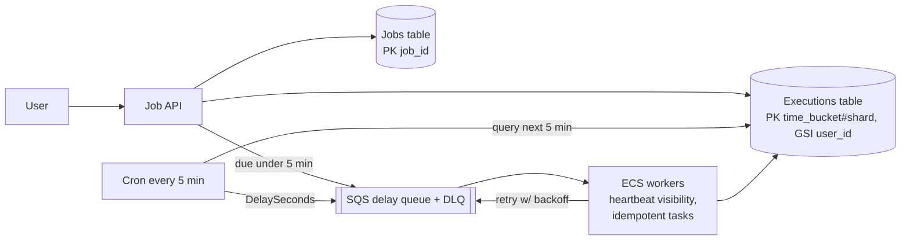

# 16 · Distributed Job Scheduler (Airflow-like): Study Notes

**Difficulty:** Medium · **Patterns:** Managing Long Running Tasks, Scaling Writes · **Source:** https://www.hellointerview.com/learn/system-design/problem-breakdowns/job-scheduler
*My own summary of the Hello Interview breakdown. Read the original for diagrams and full detail.*

## Key terms
- **Task:** reusable work, e.g. "send email".
- **Job:** one use of a task, with a schedule and parameters, e.g. "email john at 10:00 Friday".

## Requirements
**Functional:** schedule jobs to run now, at a future time, or on a CRON schedule; monitor job status.
**Out of scope:** cancel or reschedule.

**Non-functional**
- Availability over consistency
- **Run within 2 seconds of the scheduled time**
- **10k jobs a second**
- **At-least-once execution**

## Core entities
Task, Job, Schedule (CRON or a specific date), User.

## API and data flow
- `POST /jobs {task_id, schedule: "0 10 * * *", parameters}`
- `GET /jobs?user_id&status&start_time&end_time`
- **Flow:** persist → a worker picks it up on time → retry with backoff on failure → update status.

## High-level design
- **Database:** DynamoDB or Cassandra (Postgres works too).
- **Key insight: separate the job definition from its executions,** like a recurring calendar event and its occurrences.
  - **Jobs table:** PK job_id, with schedule {type, expression} and parameters.
  - **Executions table:**
    - PK `time_bucket` (the hour); SK `execution_time-job_id`.
    - "What runs soon" queries only 1–2 partitions.
    - When a recurring job finishes, insert its next execution.
- **Monitoring:** status values PENDING, IN_PROGRESS, COMPLETED, FAILED, RETRYING. A **GSI on user_id** (SK execution_time) lets users list their jobs.

## Deep dives
### 1. Running within 2 seconds
- Polling the database every 2 seconds would mean pulling ~20k rows each time. Too much load and too slow.
- **Two layers:**
  1. A cron runs every **5 minutes** and fetches the executions due in the next 5 minutes.
  2. It pushes them into a **delay queue**; workers take them exactly on time.
  3. Jobs created for less than 5 minutes out go **straight to the queue**.
- **Kafka doesn't fit:** it's FIFO within a partition, so a job due sooner would wait behind the others.
- **Delay-queue options:**
  - Good: Redis ZSET scored by time. Fast, but you build retries and high availability yourself.
  - Good: RabbitMQ with TTL + dead-letter exchange. Needs quorum queues for HA.
  - **Great: SQS with DelaySeconds** (up to 15 minutes, which covers the 5-minute window). Visibility timeouts, DLQs and auto-scaling come built in.
  - If managed services aren't allowed, build a Redis priority queue.

### 2. Scaling to 10k a second
- **Job creation:** scale the service horizontally. A queue in front is optional and probably overkill.
- **Database:**
  - Jobs are partitioned by job_id, which spreads evenly.
  - The hourly time_bucket becomes a **hot partition**, so **write-shard it**: `time_bucket#shard_N`, and query all shards in parallel.
  - Move executions older than a year to S3.
- **SQS sizing:** 10k a second × 300s = 3M messages × ~200B ≈ 600MB per window. Standard queues scale on their own.
- **Workers:**
  - Containers (ECS) for a steady load: cheaper, no cold starts.
  - Lambda for spiky, short jobs.
  - Chosen: ECS on spot instances, auto-scaled on queue depth, with a pre-warmed pool.

### 3. At-least-once execution
- **Visible failures** (bug or bad input):
  - try/catch, mark RETRYING, and re-enqueue with **exponential backoff** (5s → 25s → 125s).
  - After 3 attempts, mark FAILED and send to the DLQ.
- **Invisible failures** (the worker crashed):
  - Bad: health-check polling. Doesn't scale, gives false positives, and the monitor is a single point of failure.
  - Good: **job leasing** in the database with renewals. About 50k lease updates a second, clock skew, and partitions can cause duplicates.
  - **Great: SQS visibility timeout** (~30s). The worker heartbeats with ChangeMessageVisibility, and the message reappears if the worker dies.
- **Idempotency is required** because jobs can run more than once:
  - Bad: none, so emails or money transfers repeat.
  - Good: a dedup table keyed on jobId + execution time. Extra writes and a small race window.
  - **Great: idempotent job design.** "Set counter to X" instead of "increment"; check a flag before sending; pass idempotency keys downstream.

## Architecture diagram (my own drawing)

## Key takeaways
- Split definitions from instances.
- Two-tier scheduling: a coarse database scan plus a precise delay queue.
- Time-bucket keys with write sharding.
- Visibility timeouts, at-least-once delivery and idempotent jobs.

## Game-design hooks
- Daily quests and recurring events: CRON definitions vs execution instances.
- Timed rewards delivered through a delay queue.
- Idempotent reward granting so retries don't double-reward.
