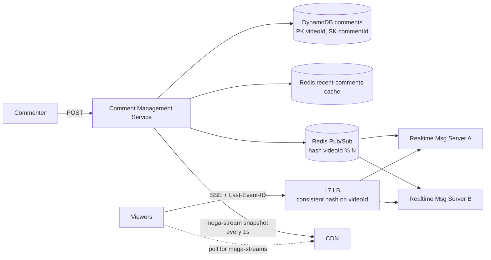

# 17 · Facebook Live Comments: Study Notes

**Difficulty:** Medium · **Pattern:** Real-time Updates · **Source:** https://www.hellointerview.com/learn/system-design/problem-breakdowns/fb-live-comments
*My own summary of the Hello Interview breakdown. Read the original for diagrams and full detail.*

## Requirements
**Functional:** post comments on a live video; see new comments as they arrive; see comments posted before you joined.
**Out of scope:** replies, reactions.

**Non-functional**
- Millions of concurrent videos, thousands of comments a second on a single video
- Availability over consistency
- **Under 200ms end to end.** About 200ms is where people perceive "instant".

## Core entities
User (viewer or broadcaster), LiveVideo (owned by another team), Comment.

## API
- `POST /comments/:liveVideoId {message}`. The user comes from the JWT.
- `GET /comments/:liveVideoId?cursor=<last_comment_id>&pageSize&sort=desc`

## High-level design
- **Path:** Commenter client → Comment Management Service → **DynamoDB**.
- **v1 live updates:** poll with `?since=lastId`. Too much load and not real-time.
- **History scrolling:**
  - **Offset pagination** (bad): slow at large offsets, and the list shifts as comments arrive, causing duplicates or gaps.
  - **Cursor pagination** (great): `commentId < cursor`, newest first, LIMIT n. Stable and fast with an index.

## Deep dives
### 1. Real-time push
- **WebSockets** (good): two-way, but wasteful when nearly every viewer only reads.
- **SSE** (great): one-way push over HTTP, with comments posted through plain POST.
  - Watch for proxies that buffer, the browser's per-domain connection limit, and harder monitoring.

### 2. Scaling to millions of viewers
- One server holds about 100k connections, limited by CPU, memory and file descriptors.
- **Myth:** 65,535 is the number of ports, not a connection limit.

**Part 1: coordinating servers** (viewers of one video are spread across servers)
- **Split out Realtime Messaging Servers** for reads, apart from the write path.
  - Each keeps a local map of liveVideoId → [connections].
- **Good: naive Pub/Sub.** Every server gets every comment, which wastes CPU.
- **Great: partitioned Pub/Sub with co-location.**
  - Channels = `hash(videoId) % N`.
  - An **L7 load balancer uses consistent hashing on videoId** to send viewers of the same video to the same server, or a ZooKeeper map does it.
- **Great: a Dispatcher service.**
  - The dispatcher knows which servers serve which videos (heartbeats and registration through ZooKeeper or etcd) and forwards comments directly.
  - Keeping that mapping fresh during viral spikes is the hard part.
- **Pub/Sub technology choice:**
  - Kafka struggles when subscriptions change constantly.
  - **Redis Pub/Sub** handles that well, and fire-and-forget is fine because comments are already stored durably.

**Part 2: mega-streams** (e.g. a World Cup final)
- At 5k comments a second, each comment is on screen for about 4ms. Nobody can read that fast; the point becomes the *vibe* of the crowd.
- **Good: show a representative sample.**
  - Adjust the sampling rate so each viewer gets roughly the same rate however fast comments arrive.
  - Favor comments from friends, popular comments and verified accounts.
- **Great: CDN snapshots.**
  - Keep a ring buffer of the last 100–200 comments and write a snapshot every ~1 second to the CDN origin.
  - Clients poll the CDN every second and **animate** new comments in, spaced across the interval.
  - Switch modes automatically above a threshold (e.g. 100k viewers or 500 comments a second), with **hysteresis** so it doesn't flip back and forth.
  - **Read-your-own-write:** the client inserts its own comment locally right away.
  - Staff-level insight: at extreme scale the requirements themselves change.

### 3. Disconnections
- Bad: ignore them, so gaps appear.
- **Great: SSE `Last-Event-ID`** (the comment ID).
  - On reconnect, replay what was missed.
  - Clients also track their position and catch up with `GET ?since=`.
  - **Replay only a bounded window** (about 5 minutes).
  - Show "You missed 47 comments" or replay at 2–3x speed.
  - On mobile, disconnect when backgrounded.
  - A shared Redis cache of recent comments lets any server replay.
  - Dedupe on IDs when merging SSE with HTTP catch-up.

## Architecture diagram (my own drawing)

## Key takeaways
- SSE suits read-heavy push.
- Co-locate viewers by key and partition Pub/Sub.
- At mega scale, change the product: sample comments or poll CDN snapshots.
- Last-Event-ID plus bounded replay handles reconnects.

## Game-design hooks
- Live spectator chat or reactions during matches.
- A "crowd hype meter" built from sampled comments.
- Ring-buffer snapshots for huge events.
- Optimistic local insert of your own message.
