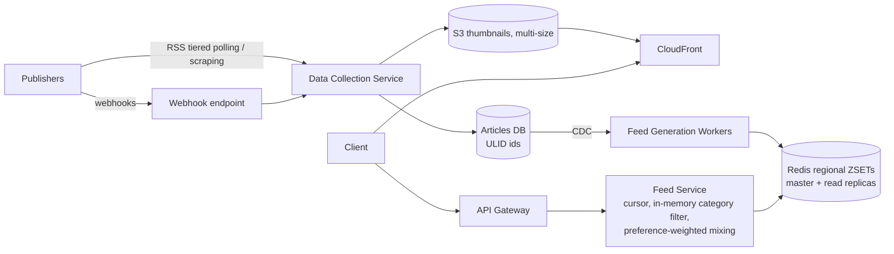

# 18 · News Aggregator (Google News): Study Notes

**Difficulty:** Medium · **Pattern:** Scaling Reads · **Source:** https://www.hellointerview.com/learn/system-design/problem-breakdowns/google-news
*My own summary of the Hello Interview breakdown. Read the original for diagrams and full detail.*

## Requirements
**Functional:** an aggregated feed from thousands of publishers worldwide; infinite scroll; click through to the publisher's site.
**Out of scope:** interest customization, saving, sharing.

**Non-functional**
- Availability over consistency (stale news beats no news)
- 100M daily users with spikes up to 500M
- **Feed loads in under 200ms**

## Core entities
- Article (title, summary, thumbnail URL, published_at, publisher, region, URL)
- Publisher (feed URL, region)
- User (region)

## API
- `GET /feed?page&limit&region` → Article[]. This becomes cursor-based later.
- Clicking an article is just a browser navigation. A real system would log the click through `GET /article/:id`, then 302 to the publisher.

## High-level design
- **Data Collection Service (background):**
  - Polls each publisher's **RSS** every 3–6 hours and parses the XML.
  - **Downloads thumbnails into our own object storage** so we control speed, availability and sizes.
  - Saves articles to the database.
- **Feed Service (user-facing):** API Gateway → Feed Service → DB, filtered by region and newest first.
  - Kept separate from collection because their scaling and operations are completely different.
- **v1 pagination:** offset-based.

## Deep dives
### 1. Consistent pagination
- **Offset pagination** drifts as new articles arrive at the top, so users see duplicates or miss items.
- **Good: timestamp cursor** (`published_at < cursor`). Articles with **identical timestamps** (batch imports) get skipped.
- **Great: composite cursor** `(published_at, article_id)` using tuple comparison and a composite index.
- **Great: monotonically increasing IDs** (ULID or auto-increment) so the ID alone is the cursor: `id < cursor ORDER BY id DESC`. Needs planning up front and a coordinated ID generator.

### 2. Feeds under 200ms
- **Estimate:** 100M users × 5–10 refreshes ≈ 0.5–1B feed requests a day.
- **Good: Redis sorted set per region** (`feed:US`) with a 30-minute TTL, cache-aside.
  - Content can be up to 30 minutes stale.
  - A **thundering herd** hits the database when the TTL expires.
- **Great: precomputed feeds updated through CDC.**
  - A database insert fires CDC → Feed Generation Workers ZADD the article into the regional ZSET.
  - Limit each feed's size with `ZREMRANGEBYRANK` (keep ~1–2k articles), so no TTL is needed.
  - Reads take about 5ms.

### 3. New articles in the feed within 30 minutes
- Often you're allowed to "black-box" ingestion; ask the interviewer.
- **Good: tiered RSS polling.** High priority every 5–10 minutes, medium every 30, low every 2–3 hours.
  - Use ETag and Last-Modified to skip feeds that haven't changed.
  - The cost is 100k+ requests an hour, the risk of getting IP-blocked, and some publishers have no RSS.
- **Good: web scraping** as a fallback, using CSS selectors and fingerprints (see Web Crawler). Fragile, and carries legal risk.
- **Great: publisher webhooks** (`POST /webhooks/article-published`, authenticated) with polling and scraping as fallbacks. Needs publishers to opt in, which is plausible at 100M users.

### 4. Thumbnails
- Bad: blobs in the database.
- Good: S3 + URLs. Slow far from the region, and egress is costly.
- **Great: S3 + CloudFront** with **several sizes** (150×100, 300×200, 600×400 for retina) served through `srcset`. Over 90% fewer S3 hits.

### 5. Breaking-news spikes (~10M concurrent users)
- **News is regional:** deploy each region separately so spikes stay isolated.
- **Feed Service:** stateless and auto-scaled.
- **The database is shielded by the cache.**
- **Redis:**
  - About 100k requests a second per instance, so about 100 instances overall.
  - Use **read replicas** (no sharding needed for ~2k articles) with Sentinel failover.
  - Add replicas during spikes.

### 6. Category feeds (bonus)
- Bad: filter by category in the database on every request. 250 region×category combinations.
- Good: a ZSET per category and region (`feed:sports:US`). More memory and more complex cleanup.
- **Great: filter in memory.**
  - Store the full article JSON, including category, in the regional ZSET.
  - Read the top 1000 (~10ms) and filter in the app (1–2ms).
  - The simplest option wins.

### 7. Personalization (bonus)
- Bad: score every article for every request. Too slow.
- Good: a precomputed feed per user. 50M users × 1000 entries = 50B entries, staleness, and users may miss breaking news.
- **Great: hybrid assembly.**
  - Store a small preference vector per user.
  - Mix category feeds by weight, e.g. 60% tech, 30% business, 10% trending.
  - Boost trending during breaking news; ML tunes the ratios.
  - About 100x less memory.

## Architecture diagram (my own drawing)

## Key takeaways
- Cursor pagination with monotonic IDs.
- CDC-driven precomputed feeds avoid TTL staleness and stampedes.
- Push (webhooks) beats pull when partners will cooperate.
- In-memory filtering over a small hot set beats keeping many caches.

## Game-design hooks
- A "news ticker" or event feed with infinite scroll.
- Region-based content shards.
- Personalized mission feed built by mixing category pools with weights.
