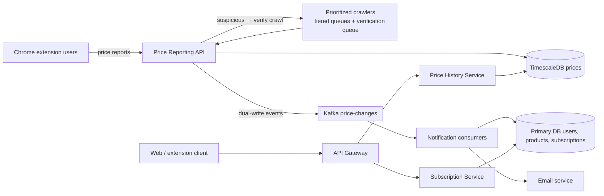

# 19 · Price Tracking Service (CamelCamelCamel): Study Notes

**Difficulty:** Medium · **Patterns:** Scaling Writes, Multi-step event pipelines · **Source:** https://www.hellointerview.com/learn/system-design/problem-breakdowns/camelcamelcamel
*My own summary of the Hello Interview breakdown. Read the original for diagrams and full detail.*

## Requirements
**Functional:** view a product's Amazon price history (website or Chrome extension, which has about 1M users); subscribe to price-drop alerts with a threshold.
**Out of scope:** search, comparing retailers, reviews.

**Non-functional**
- Availability over consistency
- **500M products**
- Price history in **under 500ms**
- **Alerts within 1 hour** of a price change

**Hidden constraint:** Amazon has no API, discourages scraping and allows about 1 request per second per IP. Be "polite".

## Core entities
Product, User, Subscription (user, product, threshold), Price (time series).

## API
- `GET /products/{id}/price?period=30d&granularity=daily` → PriceHistory[]
- `POST /subscriptions {product_id, price_threshold, notification_type}`

## Data flow
Crawlers and the extension collect prices → validate → store → a change event fires → email users whose threshold is met.

## High-level design
- **Services:** API Gateway → Price History Service (read-heavy) and Subscription Service.
- **Web Crawler** is a black box at first.
- **Two databases:**
  - **Primary DB** for users, products and subscriptions (small, ordinary CRUD).
  - **A separate Price DB:** billions of rows, append-only, time series.
- **v1 alerts:** a cron every 2 hours scans recent price changes, matches subscriptions with threshold ≥ the new price, and sends email. Slow and expensive.

## Deep dives
### 1. Discovering and tracking 500M products
- The problem has two halves: **discovery** (~3k new products a day) and **monitoring** (refreshing prices).
- **Bad: naive BFS crawling.**
  - 500M pages at 1 request a second ≈ 15+ years per pass on one IP, or 5+ days even with 1000 IPs.
- **Good: prioritize by user interest** (popularity follows a Pareto curve).
  - Score products by subscriptions and searches.
  - Tiered queues: hot every few hours, warm daily, cold weekly.
  - Feedback: notifications that led to clicks raise the score.
  - Blind spot: new trending products.
- **Great: crowdsource through the Chrome extension.**
  - The 1M users report the product ID and price from the pages they view, which naturally covers popular items and finds new ones.
  - Crawlers only fill the gaps.
  - Interviewers usually hint at this: "your extension sits on millions of browsers…".

### 2. Fake or malicious price reports
- Example: someone reports an iPhone at $0.01, triggering false alerts and destroying trust.
- **Good: consensus.**
  - Hold the update until N distinct users report the same price within a window.
  - Require more confirmations for big drops or popular items; weight by user reputation.
  - Slow for niche products, and attackers can coordinate.
- **Great: trust but verify.**
  - Accept the report immediately.
  - If it looks suspicious (big drop, low-reputation reporter, many subscribers), queue a **high-priority verification crawl within 1–5 minutes**.
  - If the crawl disagrees, send a correction and lower the reporter's reputation.
  - Conflicting reports trigger an immediate crawl.

### 3. Event-driven notifications
- Turn the question around: not "what changed in the last 2 hours?" but **"who cares about this change?"** the moment it happens.
- **Option A, CDC:** price DB writes → events (product, old price, new price) → Kafka.
- **Option B, dual writes:** the collector writes to the database and publishes to Kafka. This lets you filter tiny changes and batch rapid ones.
- **Consumers** query subscriptions for that product where threshold ≥ the new price, then send email.

### 4. Fast price-history charts
- Plain Postgres with an index on (product_id, ts) is slow when aggregating years of data.
- **Good: nightly pre-aggregation.** A daily/weekly/monthly table (avg, min, max, open, close) keyed on (product, granularity, date). Up to 24 hours stale.
- **Great: TimescaleDB** (a Postgres extension).
  - Hypertables with automatic partitioning and compression.
  - On-demand `time_bucket('1 day', ts)` aggregation in milliseconds.
  - Stays inside the Postgres ecosystem. ClickHouse would be faster but adds another system.

## Architecture diagram (my own drawing)

## Key takeaways
- Spend scarce crawl budget where users care (Pareto).
- Clients can be your data-collection network.
- Trust but verify untrusted input.
- Event-driven matching beats periodic scans.
- Use a time-series database for history charts.

## Game-design hooks
- Crowdsourced data with a reputation score for players who report or verify.
- Anti-cheat "consensus vs verify".
- Threshold-based alerts ("notify me when the item drops below X").
- Time-bucket stats charts.
