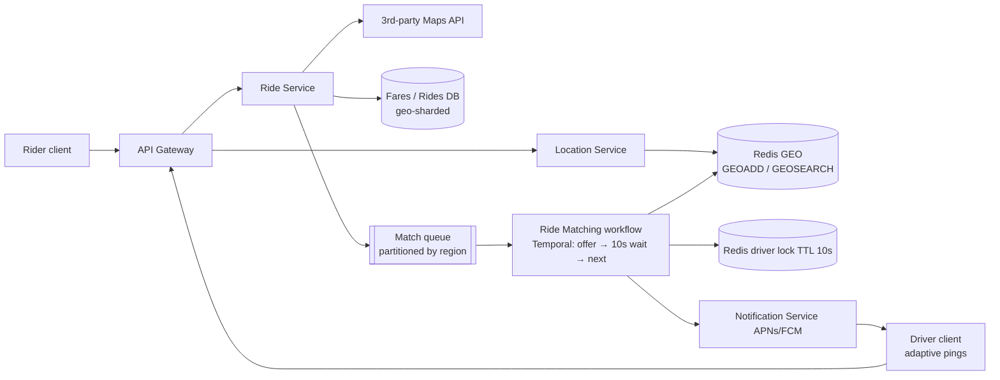

# 22 · Uber (Ride Sharing): Study Notes

**Difficulty:** Hard · **Patterns:** Proximity Search, Dealing with Contention, Multi-step Processes, Real-time Updates · **Source:** https://www.hellointerview.com/learn/system-design/problem-breakdowns/uber
*My own summary of the Hello Interview breakdown. Read the original for diagrams and full detail.*

## Requirements
**Functional**
- Rider enters pickup and destination and gets a **fare estimate**
- Request a ride at that fare
- **Match with a nearby available driver**
- Driver accepts or declines, then navigates

**Out of scope:** ratings, scheduled rides, ride categories.

**Non-functional**
- Match within **1 minute** (or fail)
- **Strong consistency:** a driver never gets two rides at once
- High throughput, e.g. **100k requests from one location** at a big event

## Core entities
Rider, Driver (vehicle, status), Fare (estimate + ETA), Ride (states, route, final fare), Location (latest driver lat/long + timestamp).

## API
- `POST /fare {pickup, destination}` → Fare
- `POST /rides {fareId}` → Ride, which kicks off matching
- `POST /drivers/location {lat, long}`. The driverId comes from the JWT.
- `PATCH /rides/:id {accept|deny}`
- **Security:** never take userId, timestamps or the fare amount from the client.

## High-level design
- **Path:** Rider client → API Gateway → **Ride Service** (fare from a third-party maps API + pricing model, stored as a Fare) → Ride row with status requested → **Ride Matching Service**.
- **Location Service:** drivers stream their positions to it.
- **Matching:** finds the nearest available drivers and ranks them.
- **Notification Service:** pushes the offer to the top driver through APNs or FCM.
  - Accept → ride is accepted and the driver gets the pickup coordinates.
  - Decline → offer the next driver.

## Deep dives
### 1. Location writes and proximity search
- 10M drivers × an update every 5 seconds ≈ **2M writes a second**. In DynamoDB that's over $200k a day.
- B-tree indexes on lat/long don't handle 2-D search.
- **Bad:** write every update straight to the database.
- **Good:** batch the writes into a geospatial database (quadtree, PostGIS). Positions are stale between batches.
- **Great: Redis GEO.**
  - Geohash stored as a 52-bit score in a sorted set.
  - `GEOADD` overwrites each driver's latest position; `GEOSEARCH` finds drivers by radius or box.
  - Clean up stale drivers with a companion ZSET of timestamps.
  - Durability: AOF/RDB + Sentinel. Even total loss heals within one 5-second update cycle.

### 2. Fewer location pings
- **Adaptive update intervals** on the device, based on speed, heading, being near a pending request, and driver status.
- **Don't neglect the client.**

### 3. Never offer two rides to one driver at once
- This is the same as the Ticketmaster seat hold: a 10-second exclusive offer.
- **Bad:** app-level locks with timers in memory. No coordination, and a crash leaves orphaned locks.
- **Good:** set the driver's status to `outstanding_request` in the database with an in-memory timeout. A crash loses the timer, so you need a cron cleanup.
- **Great: a Redis lock on driverId with a 10-second TTL.** It expires on its own if the driver doesn't respond. The cost is depending on Redis, but the locks are short-lived.

### 4. Not dropping requests at peak
- **Bad:** process requests directly. Surges and crashes drop them.
- **Great: a queue with dynamic scaling.**
  - Kafka **commits the offset only after a match**, so a crashed matcher's work is picked up again.
  - **Partition by region.**
  - FIFO can block behind slow requests; consider priority queues.
  - Managed options: SQS, MSK, Confluent.

### 5. A driver who doesn't respond
- **Good: a delay queue.**
  - Schedule a 10-second delayed message alongside each offer.
  - When it fires, if the ride is still unassigned, offer the next driver.
  - Late accepts are tricky to handle.
- **Great: durable execution (Temporal or Step Functions).**
  - Loop: offer the next driver → wait 10s → stop on accept, otherwise continue.
  - State survives crashes.
  - Uber wrote Cadence, which became Temporal. **Human-in-the-loop steps are the signal for this pattern.**

### 6. Scaling further
- Bad: vertical scaling.
- **Great: geo-shard** services, queues and databases, with read replicas. Scatter-gather only at shard boundaries. Consistent hashing + replication.

## Architecture diagram (my own drawing)

## Key takeaways
- In-memory geo index for fast-moving location data.
- A short TTL lock is the exclusive offer.
- Queue with offset-after-success.
- Durable workflows for steps that wait on a human with timeouts.
- Geo-sharding.

## Game-design hooks
- Location-based matchmaking ("find nearby players").
- A timed accept/decline invite with fallback to the next candidate.
- Surge-event queueing.
