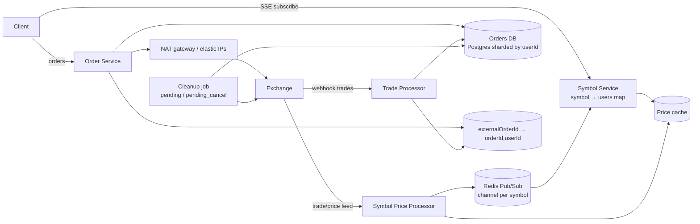

# 23 · Robinhood (Stock Brokerage): Study Notes

**Difficulty:** Hard · **Patterns:** Real-time Updates, Multi-step Processes (consistency) · **Source:** https://www.hellointerview.com/learn/system-design/problem-breakdowns/robinhood
*My own summary of the Hello Interview breakdown. Read the original for diagrams and full detail.*

## Background
- **Symbol / ticker:** the short code for a stock, e.g. META.
- **Market order:** buy or sell now at the current price (number of shares only).
- **Limit order:** buy or sell at a target price; it can sit on the exchange until filled or cancelled.
- **Robinhood is a broker, not an exchange.**
- **Exchange interface (agree on it with the interviewer):**
  - A synchronous API to place and cancel orders.
  - A pushed **trade feed** per symbol (symbol, price, shares, orderId).

## Requirements
**Functional:** see live prices; manage orders (market or limit; create, cancel, list).
**Out of scope:** after-hours trading, ETFs/options/crypto, live order book.

**Non-functional**
- **Strong consistency for orders**
- Scale: 20M daily users × 5 trades, thousands of symbols
- **Under 200ms** for price updates and order placement
- **Keep exchange connections to a minimum** (they're expensive)

## Core entities and API
- **Entities:** User, Symbol, Order.
- `GET /symbol/:name` → later replaced by `GET /subscribe?symbols=...` over SSE
- `POST /order {position, symbol, priceInCents, numShares}`. **Use integer cents, never floats, for money.**
- `DELETE /order/:id`
- `GET /orders` (paginated, user from the JWT)

## High-level design
### Live prices
- **Bad:** clients poll the exchange. Thousands of identical calls, and slow.
- **Good:** clients poll an internal cache. A **Symbol Price Processor** listens to the exchange once and updates the cache. Polling still wastes requests and adds latency.
- **Great: SSE.**
  - Send the initial prices from the cache, then push changes.
  - Needs sticky sessions and reconnect handling.

### Orders
- **Bad:** clients send orders straight to the exchange. Too many connections, no tracking, and the client is the only record.
- **Good:** Order Service → queue → dispatcher. Scales, but queue lag breaks the 200ms target at peaks.
- **Great: Order Service → order gateway** (an AWS NAT gateway with a few Elastic IPs).
  - Requests appear to come from a small set of IPs.
  - The Order Service is over-provisioned or scales on a sensitive trigger, and may batch orders.
- **Order DB:** relational (ACID), **partitioned by userId**.
  - Status: pending → submitted → filled or cancelled.
  - Stores the `externalOrderId` from the exchange.
- **Trade Processor:** receives exchange trade updates, typically through a registered webhook behind a load balancer.

## Deep dives
### 1. Scaling live price fan-out
- **Redis Pub/Sub with one channel per symbol.**
  - Each Symbol Service server keeps a map of symbol → Set<userId> for its connected users.
  - It subscribes to a channel when its first user wants that symbol, and **unsubscribes when the last one leaves** (heartbeats detect disconnects).
  - The price processor publishes and servers fan out to their own users. It regulates itself.

### 2. Tracking order updates
- Trades arrive keyed by externalOrderId, but the Order DB is sharded by userId.
- **Add a key-value map** (e.g. RocksDB): externalOrderId → (orderId, userId).
  - Written by the Order Service after submission.
  - The Trade Processor looks up the shard, then updates the order.

### 3. Order consistency (fault tolerance)
- **Create flow:**
  1. Insert the order as **pending first**, so there's always a record.
  2. Submit to the exchange synchronously and get the externalOrderId back.
  3. Write the key-value mapping and set the order to submitted.
  4. Respond to the client.
- **Failures:**
  - Store fails → return an error.
  - Exchange submit fails → mark failed.
  - Post-submit update fails → a **cleanup job** queries the exchange by **clientOrderId** to reconcile (record the ID, or mark failed).
- **Cancel flow:**
  1. Set **pending_cancel**.
  2. Cancel on the exchange.
  3. Mark cancelled.
  4. Respond.
  - Any failure after step 1 is resolved by the cleanup sweep over pending_cancel orders.
- **Principle:** write an intent state before the external call, then reconcile asynchronously.

### Extra follow-ups
Throttling bursts of price updates to clients, batching orders to the exchange, live order-status updates, historical price and portfolio charts.

## Architecture diagram (my own drawing)

## Key takeaways
- Proxy expensive upstream feeds once and fan out internally.
- SSE + per-key Pub/Sub that subscribes and unsubscribes on demand.
- Pending-first writes + idempotent client IDs + reconciliation jobs keep external calls consistent.
- Integer cents for money.

## Game-design hooks
- An in-game market or economy ticker over SSE.
- Order-book or auction mechanics.
- Pending-state + reconciliation for purchases that go through external payment providers.
