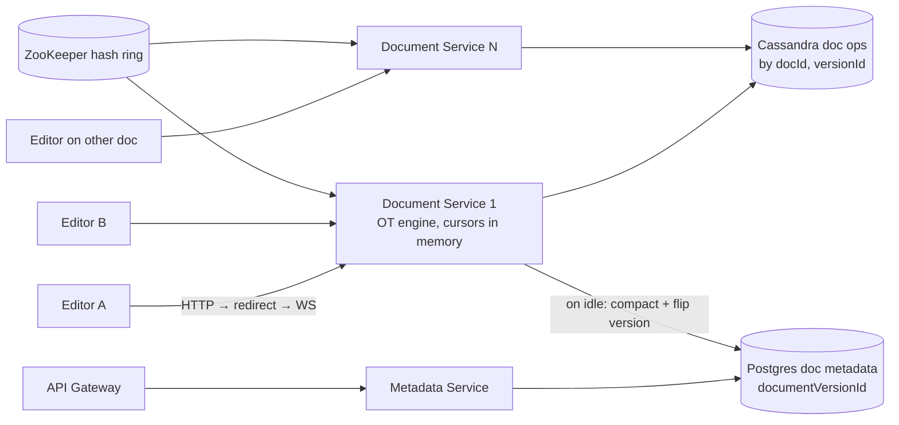

# 24 · Google Docs (Collaborative Editor): Study Notes

**Difficulty:** Hard · **Patterns:** Real-time Updates, Dealing with Contention · **Source:** https://www.hellointerview.com/learn/system-design/problem-breakdowns/google-docs
*My own summary of the Hello Interview breakdown. Read the original for diagrams and full detail.*

## Requirements
**Functional:** create documents; several users edit at once; see each other's changes in real time; see other users' cursors and presence.
**Out of scope:** rich structure, permissions, version history.

**Non-functional**
- **Eventually consistent:** everyone converges on the same document
- Edits show up in **under 100ms**
- Millions of concurrent users, billions of documents
- **At most 100 concurrent editors per document.** This constraint helps a lot; Google Docs makes extra users read-only.
- Durable across server restarts

## Core entities
Editor, Document, Edit, Cursor (position + presence).

## API
- `POST /docs {title}` → docId
- `WS /docs/{docId}`:
  - Send: `insert`, `delete`, `updateCursor`
  - Receive: `update`

## High-level design
- **Metadata:** an ordinary CRUD service behind the API gateway, on Postgres.

### Why concurrent editing is hard
- **Sending whole-document snapshots** is wrong: hundreds of KB per keystroke, and the last write wins, so concurrent edits are lost.
- **Sending raw operations** (`INSERT(5,", world")`, `DELETE(6)`) is closer, but each operation assumes a particular document state, so applying them in a different order corrupts the text.
- **Two real fixes:**
  - **OT, Operational Transformation** (good):
    - A central server orders the operations and **rewrites** each one against the operations before it (e.g. `DELETE(6)` becomes `DELETE(13)`).
    - Low memory and fast, but hard to get right and needs a central server. Fine with ≤100 editors.
  - **CRDT** (good):
    - Operations **commute**: positions are IDs that can always be subdivided (4 → 4.3 → 4.35), and deletes leave **tombstones**.
    - Every replica converges no matter the order. No central server needed, works peer-to-peer and offline (e.g. Yjs).
    - Memory only grows (tombstones), it's computationally heavier, and concurrent edits at the same spot merge awkwardly ("Hello t,here!").
- **Chosen: OT** (what Google Docs uses). CRDTs win for very large groups, P2P or offline (Figma uses a CRDT-like approach).

### The pipeline
- **Document Service** (WebSocket) transforms operations → **Cassandra Document Operations DB** (append-only, partitioned by docId, ordered by server timestamp) → ACK to the client once it's durable.
- **On load:** replay every stored operation down the socket.
- **On update:** broadcast to the other editors on the same server.
- **Clients run OT too,** because their own edits are applied locally first and orders differ between clients.
- **Cursors and presence are ephemeral:**
  - Kept in the Document Service's memory and broadcast over the socket.
  - Sent to new joiners; removed on disconnect.
  - Never stored with the document.

## Deep dives
### 1. Millions of WebSockets
- **Every editor of a document must land on the same server.**
- **Consistent hash ring in ZooKeeper:**
  1. The client connects to any server over HTTP.
  2. If that server doesn't own the document, it **redirects** to the one that does.
  3. The connection upgrades to a WebSocket.
  4. The owning server loads the operations and keeps a map of docId → sockets.
- **Terminate WebSockets at the edge** and expose internal APIs, so other services stay stateless. Think about the right-to-left arrows (server → client).
- **When servers join or leave:**
  - Track both the old and new ring during the transition.
  - Move connections and document state.
  - Clients need reconnect logic.
  - Watch for hotspots.

### 2. Keeping storage under control
- 50KB × billions of documents ≈ 50TB, and replaying millions of operations is slow. Active documents also sit in memory.
- **Snapshot / compact** the operations.
- **Good: an offline Compaction Service.**
  - Read the operations, collapse them into roughly one insert, and write them under a **new documentVersionId**.
  - Ask the Document Service to **flip** the version pointer in the metadata database; it refuses while the document is loaded.
  - Cassandra only has row-level atomicity, hence the version flip. Tricky orchestration; throttle it.
- **Great: online compaction** inside the Document Service.
  - When the **last client disconnects**, it already owns the document and has all its operations in memory.
  - Compact in a low-priority process, write the new version, flip the pointer.
  - Watch p99 CPU.

### Extra follow-ups
- Read-only mode for millions of viewers.
- Version history using snapshots.
- Reducing memory use.
- Offline editing.

## Architecture diagram (my own drawing)

## Key takeaways
- OT vs CRDT trade-offs (central server vs commutative operations, memory, offline).
- Route by document key with a consistent hash ring and redirects.
- Ephemeral presence state lives in memory.
- Compact when idle, with a version-pointer flip.

## Game-design hooks
- Real-time co-op level editors (OT or CRDT).
- Shared puzzle boards.
- Live cursors and presence of teammates.
- Replay from an operation log with snapshots.
