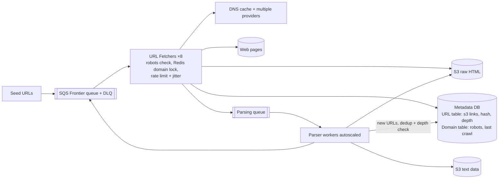

# 25 · Web Crawler (for LLM training data): Study Notes

**Difficulty:** Hard · **Patterns:** Managing Long Running Tasks, Scaling Writes, pipelines · **Source:** https://www.hellointerview.com/learn/system-design/problem-breakdowns/web-crawler
*My own summary of the Hello Interview breakdown. Read the original for diagrams and full detail.*

## Requirements
**Purpose:** collect text to train an LLM. The goal shapes the design; a search engine would also need indexing and ranking.

**Functional:** crawl from seed URLs; extract each page's text and store it.
**Out of scope:** training itself, images and video, JavaScript-rendered pages, logged-in pages. You can't reach the whole web, just most of it.

**Non-functional**
- **Fault tolerant:** resume without losing progress
- **Polite:** obey robots.txt, don't overload sites
- **Finish within 5 days**
- **10B pages** at ~2MB each (worst case for bandwidth; the HTML alone is ~30KB)

## Interface and data flow
- **Input:** seed URLs (ask whether they're given). **Output:** extracted text.
- **Flow:**
  1. Take a URL from the frontier.
  2. DNS lookup.
  3. Fetch the HTML.
  4. Extract text and store it.
  5. Extract links and add them to the frontier.
  6. Repeat.

## High-level design
Frontier queue → Crawler → DNS → web page → S3 for the text. The dotted box marks the system boundary.

## Deep dives
### 1. Fault tolerance
- **Split into pipeline stages:**
  1. **URL Fetcher** stores raw HTML in S3.
  2. **Parser** (text + URL extraction) writes text to S3 and pushes new URLs.
  - Failures are isolated, each stage scales on its own, and you can **re-parse without re-fetching** when the ML team changes the extraction rules.
- **Metadata DB** (DynamoDB or Postgres): a URL table with S3 links.
  - **Queue messages carry only IDs, never the HTML.**
- **Retrying failed fetches:**
  - Bad: in-memory timer.
  - Good: a Kafka retry topic with hand-built backoff.
  - **Great: SQS.**
    - The visibility timeout combined with `ChangeMessageVisibility` scaled by `ApproximateReceiveCount` gives exponential backoff.
    - After maxReceiveCount (5), the message goes to the **DLQ** and the site is treated as offline.
- **A crawler crash** loses nothing:
  - Kafka: offsets aren't committed until the URL is processed.
  - SQS: the message is only deleted after the HTML is stored.

### 2. Politeness
- **robots.txt:** `Disallow` paths and `Crawl-delay`.
  - Crawl-delay isn't in the official standard and Googlebot ignores it, but respecting it is good manners.
- **Store each domain's parsed robots rules and last crawl time** in a Domain table.
  - Disallowed URL → ack and skip.
  - Too soon → defer with ChangeMessageVisibility. (DelaySeconds only works on new messages.)
- **Crawlers racing on the same domain:** a **Redis per-domain lock** (`SET NX` with TTL = crawl delay).
- **A global limit of 1 request per second per domain:** a Redis sliding window.
  - Add **jitter** so waiting crawlers don't all retry at the same instant.

### 3. Scale: 10B pages in 5 days
- **One big network instance:**
  - 200 Gbps ÷ 8 ÷ 2MB ≈ 12.5k pages a second.
  - At ~30% realistic utilization, about **3,750 pages a second**.
  - 10B ÷ 3,750 ≈ 31 days on one machine, so **8 machines ≈ 3.9 days**.
- **1 request per second per domain still allows thousands a second overall** because millions of domains are crawled in parallel.
- **Parsers:** auto-scale on queue depth (Lambda or Fargate).
- **DNS is a hidden bottleneck.** In the Mercator crawler, DNS took up to 70% of thread time.
  - Cache lookups.
  - **Round-robin across several DNS providers** (a practical staff-level idea).
- **Efficiency:**
  - **URL dedup:** check the Metadata DB before enqueueing.
  - **Content dedup:** different URLs can serve the same page, so hash the content and:
    - Great: store the hash with an **index** in the database. Simple and practical.
    - Great: a **Bloom filter** (RedisBloom `BF.ADD` / `BF.EXISTS`). False positives are possible; arguably overkill.
- **Crawler traps:** cap link-hop **depth at ~15–20**.

### Extra follow-ups
- JavaScript-rendered pages (headless Puppeteer).
- Monitoring.
- HEAD requests to skip files over 10MB.
- Continuous recrawls with a **URL Scheduler**.
- Priority crawling with several SQS queues.

## Architecture diagram (my own drawing)

## Key takeaways
- Pipeline the stages, pass IDs in messages and keep blobs in S3.
- Visibility timeouts for backoff, plus DLQs.
- Politeness through per-domain locks, rate limits and jitter.
- Size the fleet from bandwidth.
- Don't forget DNS.
- Dedup both URLs and content.

## Game-design hooks
- A procedural "explore the graph" mechanic with a depth limit and dedup of visited nodes.
- Politeness and cooldowns per area.
- A pipeline-building puzzle (fetch → parse → store).
