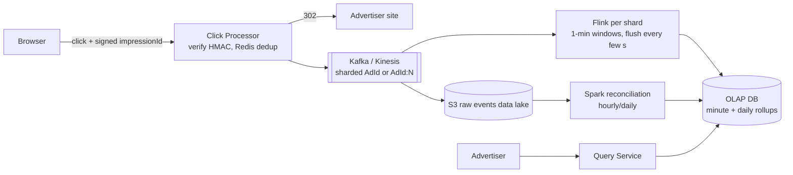

# 26 · Ad Click Aggregator: Study Notes

**Difficulty:** Hard · **Pattern:** Scaling Writes (streaming) · **Source:** https://www.hellointerview.com/learn/system-design/problem-breakdowns/ad-click-aggregator
*My own summary of the Hello Interview breakdown. Read the original for diagrams and full detail.*

## Requirements
**Functional:** clicking an ad redirects to the advertiser's site; advertisers query click metrics over time at **1-minute** granularity.
**Out of scope:** targeting, ad serving, cross-device tracking, offline channels.

**Non-functional**
- 10M active ads, **10k clicks a second at peak** (~1k on average, ≈100M a day)
- Advertiser queries **under a second**
- **Never lose a click,** and counts must be accurate
- As close to real time as possible
- **Idempotent:** don't count the same click twice

**Out of scope:** fraud, demographics, conversions.

## Interface and data flow
- **Input:** clicks. **Output:** metrics.
- **Flow:**
  1. The user clicks.
  2. The click is tracked.
  3. The user is redirected.
  4. Advertisers query aggregates.

## High-level design
### Redirect
- Good: redirect in the client and POST the click in parallel. Users can bypass tracking.
- **Great: redirect from the server** (`/click` logs the click, then 302). Every click is captured, and tracking parameters can be added.

### Making metrics fast to query
- **Bad:** keep raw events in one database and GROUP BY at query time. Collapses at 10k a second.
- **Good: raw events + batch aggregation.**
  - Raw events go to **Cassandra** (LSM: commit log → memtable → SSTables; good for writes, bad for range aggregation).
  - **Spark** runs every N minutes, roughly 3M events or 300MB per 5-minute batch. A single machine could handle that, but MapReduce is easy to reason about.
  - Results go to an **OLAP** store (Redshift, Snowflake, BigQuery). Columnar storage makes aggregations fast.
  - **Why not a time-series database:** millions of adIds plus many dimensions (device, geo, campaign) is high cardinality and multi-dimensional, which OLAP handles better.
  - Problems: minutes of delay, and traffic spikes cause batches to run long and fall behind.
- **Great: stream processing.**
  - Click Processor → **Kafka/Kinesis** → **Flink** windowed aggregation → OLAP.
  - **Why Flink rather than plain consumers:** event-time windows, watermarks, exactly-once processing and state recovery.
  - Aggregate per minute but **flush every few seconds**, so the current minute shows partial counts.

## Deep dives
### 1. 10k a second
- **Click Processor:** auto-scale behind a load balancer.
- **Stream:**
  - Kinesis allows 1MB/s or 1k records/s per shard.
  - **Shard by AdId,** with one Flink job per shard.
- **OLAP:** self-managed ClickHouse can shard by AdvertiserId; Snowflake and BigQuery scale on their own.
- **Hot shards** (e.g. a viral Nike ad):
  - Use the key `AdId:0..N` for hot ads only.
  - Flink strips the suffix before writing; SUM upserts merge the partial counts correctly.

### 2. Never losing clicks
- **Stream replication + retention (e.g. 7 days).** If Flink dies, replay from a timestamp.
- **Checkpointing?**
  - For 1-minute windows it's **arguably unnecessary**: at most a minute is lost, and replay covers it.
  - Questioning standard advice like this is a seniority signal.
- **Reconciliation (Lambda architecture):**
  - Archive raw events to S3 with Kafka Connect or Kinesis Firehose.
  - A daily or hourly **Spark** job recomputes totals, compares them with Flink's, and corrects the OLAP data.
  - **Speed layer + batch layer.**

### 3. Duplicate clicks
- **Bad:** dedup on (userId, adId). Needs login, and it breaks **retargeting**, where the same user should see the same ad more than once.
- **Great: a unique impression ID** for every ad rendering.
  - **Dedup before the stream**, because Flink windows can't catch a duplicate that straddles a minute boundary: check a Redis cache of impression IDs.
  - **Sign (impressionId + adId) with an HMAC** so forged IDs and replays against other ads are rejected. Takes microseconds.
  - **Order: write to the stream first, then the cache.** A rare duplicate gets fixed by reconciliation; a lost click can't be recovered.
  - Cache size: 100M × 16 bytes ≈ 1.6GB. Use Redis Cluster with replicas and persistence.

### 4. Fast queries over long ranges
- Add daily and weekly **rollup tables** in the OLAP store (nightly job). Query the coarse table first and drill down from there.

## Architecture diagram (my own drawing)

## Key takeaways
- Stream (Flink) for freshness plus batch (Spark) for correctness: the Lambda architecture.
- Dedup with idempotency keys before windowed aggregation.
- Salt hot keys and recombine with SUM.
- Server-side redirects so tracking can't be bypassed.

## Game-design hooks
- Real-time analytics for game events (clicks, plays) with minute buckets.
- Signed impression or reward IDs to stop replay cheating.
- Reconciliation jobs for in-game currency ledgers.
