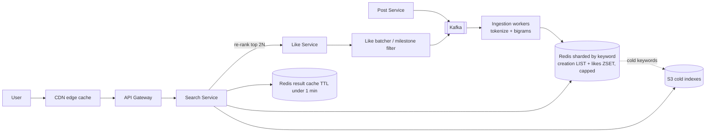

# 27 · Facebook Post Search (without Elasticsearch): Study Notes

**Difficulty:** Hard · **Patterns:** Scaling Reads, Scaling Writes, indexing fundamentals · **Source:** https://www.hellointerview.com/learn/system-design/problem-breakdowns/fb-post-search
*My own summary of the Hello Interview breakdown. Read the original for diagrams and full detail.*

## Context
- An infrastructure-style interview.
- **Elasticsearch and built-in full-text indexes are banned,** so you have to build the indexing yourself. Interviewers really do this.

## Requirements
**Functional:** create and like posts; search by keyword; sort by recency or by like count.
**Out of scope:** fuzzy matching, **personalization** (dropping it makes caching effective), privacy rules, fancy ranking, media, live result updates.

**Non-functional**
- Median query under 500ms
- High query volume
- **New posts searchable within 1 minute**
- **Every post discoverable,** though old or unpopular ones can be slower (a hint at hot/cold tiers)
- Highly available

## Scale estimates (they shape the design)
- 1B users × 1 post a day ÷ 100k seconds ≈ **10k posts a second**
- 10 likes per user per day ≈ **100k likes a second**
- 1 search per user per day ≈ **10k searches a second**
- **So the system is write-heavy, and likes dominate.**
- **Storage:** 1B posts a day × 365 × 10 years ≈ 3.6T posts × 1KB ≈ **3.6PB**

## Core entities and API
- **Entities:** User, Post, Like (mostly the count matters).
- **API:**
  - `POST /posts`, `POST /likes` (in practice consumed from an event bus)
  - `GET /search?query&sort=likes|time&cursor`

## High-level design
- **Write path:** the Post and Like services feed an **Ingestion Service** that writes the index.
- **Read path:** API Gateway → Search Service (horizontally scaled) → index.
- **Index:**
  - Bad: `LIKE '%kw%'`. Sharding only divides the full scan.
  - **Great: an inverted index** of keyword → [postIds] in **Redis** (MemoryDB if you need durability).
  - The Ingestion Service **tokenizes** each post and appends its ID to every keyword's list, so one post can mean 10–1000 writes.
- **Sorting:**
  - Bad: fetch every ID, look up timestamps and likes, sort in memory. Hundreds of MB and millions of lookups.
  - **Great: two indexes per keyword.**
    - A **creation index** (Redis LIST, appended to).
    - A **likes index** (Redis ZSET scored by likes).
    - Doubles the storage, and every like updates a score.

## Deep dives
### 1. Heavy query traffic
- With no personalization, identical queries give identical results.
- **Good: a Redis result cache with TTL under 1 minute** (stays within the freshness requirement).
- **Great: a CDN edge cache** using Cache-Control headers, so hits return in tens of milliseconds.

### 2. Multi-word and phrase queries
- **Good: intersect then filter.**
  - Intersect the ID sets for "Taylor" and "Swift", then check each post actually contains the phrase.
  - Huge sets make this expensive.
- **Great: bigrams / shingles.**
  - Index adjacent word pairs ("Taylor Swift", "saw Taylor"…) so a phrase lookup hits one key.
  - The index grows about 10x, with lots of sparse keys.
  - Mitigation: only index likely bigrams (estimate frequency with a Count-Min Sketch) and fall back to intersection otherwise.

### 3. Heavy write volume
- **Post creation:**
  - **Kafka** buffers and partitions the work across ingestion workers.
  - **Shard the index by keyword** across many Redis nodes.
- **Likes:**
  - **Good: batch likes** per post over ~30 seconds (+500 at once). Only helps viral posts.
  - **Great: a two-stage architecture.**
    - Update the index's like score **only at milestones** (powers of 2 or 10), which is exponentially fewer writes. Call the field `approxLikes`.
    - At query time, take the **top 2N** by approximate likes, fetch the **exact counts** from the Like Service, re-rank and return N.
    - "Approximate retrieval + precise re-rank" is the standard IR and recommendation pattern.

### 4. Storage
- **Cap each keyword's list** at 1k–10k entries.
- **Hot/cold tiers:**
  - A batch job moves rarely searched keyword indexes from Redis to **S3 or R2**.
  - On a Redis miss, read from blob storage with a small latency penalty.

## Architecture diagram (my own drawing)

## Key takeaways
- Build an inverted index from primitives.
- One index per sort order.
- Bigrams for phrases.
- Milestone updates + precise re-ranking to survive a flood of likes.
- Cap lists and tier hot vs cold.
- Estimating first revealed the system is write-heavy.

## Game-design hooks
- Player and level search with an inverted index.
- A "trending" sort with approximate scores re-ranked precisely.
- Hot/cold content tiers.
