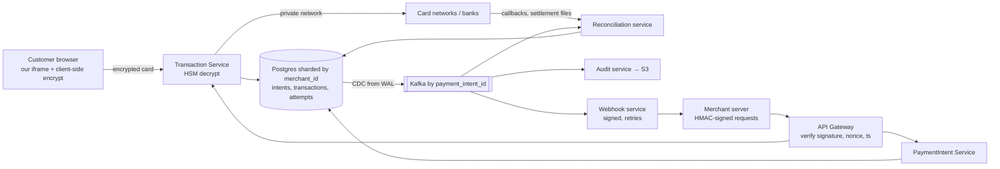

# 28 · Payment System (Stripe-like): Study Notes

**Difficulty:** Hard · **Patterns:** Multi-step Processes, CDC/event sourcing, security · **Source:** https://www.hellointerview.com/learn/system-design/problem-breakdowns/payment-system
*My own summary of the Hello Interview breakdown. Read the original for diagrams and full detail.*

## Requirements
**Functional:** merchants create payment requests; customers pay by card; merchants see status (pending, succeeded, failed).
**Out of scope:** saved cards, refunds, reports, other payment methods, subscriptions, payouts.

**Non-functional**
- **Highly secure**
- **Durable and auditable:** no transaction data is ever lost
- **Transaction safety** even though card networks are **asynchronous**
- **10k+ transactions a second** with bursts (holiday sales)

## Core entities
- **Merchant:** identity, bank account, API keys.
- **PaymentIntent:** the merchant's intent to collect an amount.
  - Owns the state machine: created → authorized → captured, canceled or refunded.
  - Enforces idempotency.
- **Transaction:** a money movement (Charge, Refund, Dispute, Payout), **many per intent**.
  - Examples: retries after a decline, partial payments, refunds.
  - Production systems also keep double-entry ledger entries.

## API
- `POST /payment-intents {amountInCents, currency, description}` → id
- `POST /payment-intents/{id}/transactions {type: charge, card...}`. Card data is never actually sent raw; see security.
- `GET /payment-intents/{id}` → status
- **Webhooks:** POST to the merchant's callback URL on status changes. Webhook design can be a whole interview on its own.

## High-level design
- **API Gateway** (auth, rate limiting) → **PaymentIntent Service** → DB, with status "created".
- **Transaction Service:**
  - Creates a pending transaction, sends the authorization request to the card network, records the first response, and listens for later callbacks (settlement, chargebacks).
  - Updates the intent's status.
- **Card networks** (Visa, Mastercard) run on private networks: HSMs, PCI DSS, ISO 8583, leased lines, mTLS.
- **Status:** clients poll the GET endpoint; webhooks come later.
- **Settlement is asynchronous** and can take minutes to days.

## Deep dives
### 1. Security
**Authenticating merchants**
- Good: a static API key in a header. It can be sniffed or leaked into code and replayed.
- **Great: request signing.**
  - Public key (identifies the merchant) + **secret key** (kept on the merchant's server).
  - The merchant sends `HMAC-SHA256(method+path+body+timestamp+nonce)`.
  - The gateway recomputes the signature, checks the timestamp window (5–15 minutes), and rejects reused **nonces**. Tampered and replayed requests both fail.

**Protecting card data**
- Bad: card data passes through the merchant's servers. Each merchant becomes a breach target and PCI liability.
- Good: an **iframe from our domain** inside the merchant page (JS SDK). Same-origin policy isolates it, but it relies on the browser.
- **Great: iframe + client-side encryption.**
  - Encrypt with our public key **before the data leaves the device**.
  - Decrypt with a private key held in **HSMs**.
  - Defense in depth.

### 2. Durability and auditability
- **Bad:** update rows in place. History is lost, bugs corrupt data silently, audits fail.
- **Good:** append-only audit tables written in the same transaction. App code can forget the insert, and audit history bloats the operational database.
- **Great: operational DB + CDC + immutable Kafka stream.**
  - CDC reads the WAL, so **every committed change is captured** without depending on application code.
  - Events carry before/after images and are keyed by payment_intent_id.
  - Consumers: Audit service, Analytics, **Reconciliation**, **Webhook delivery**.
  - Kafka replication ×3, 7–30 day retention, archived to S3 permanently.
  - **Is CDC a single point of failure?** Run several CDC instances into separate clusters, alert on lag, replay from DB logs, and fall back to direct writes from the app.

### 3. Transaction safety with asynchronous networks
- **The dangers:**
  - A timeout treated as failure → the customer retries → **double charge**.
  - Missing a success → the merchant never ships but the customer is charged.
- **Bad:** timeout = failed.
- **Good:**
  - A `pending_verification` status plus a table of network attempts.
  - A background job queries the network by reference ID.
  - **Idempotency key** with a UNIQUE (merchant, key) constraint.
  - Manual reconciliation becomes a heavy burden at peaks.
- **Great: event-driven safety with automated reconciliation.**
  1. **Record the attempt before calling the network** (CDC emits the intent).
  2. Call the network.
  3. Record the result: succeeded, failed, or timeout.
  4. **The reconciliation service** consumes timeout events, queries the network API, and processes the **daily or hourly settlement files** (the authoritative record).
  - Stripe-style **two-phase events:** "transaction created" before the DB write, "transaction completed" after. A missing completion locks the transaction until it's re-emitted.
- **Principle:** uncertainty is unavoidable, so design for eventual consistency.

### 4. Scaling to 10k a second
- **Services:** stateless behind load balancers.
- **Kafka:**
  - About 5–10k messages a second per partition, so 3–5+ partitions.
  - **Partition by payment_intent_id** to keep each intent's events in order.
  - Replication factor 3, consumer groups.
- **Database:**
  - About 10k writes a second, so **shard Postgres by merchant_id**.
  - ~500B a row ≈ 500GB a day ≈ **180TB a year**.
  - Archive data older than 3–6 months to S3.
  - Read replicas + Redis for status reads.

### Bonus: webhooks
- Merchants register a callback URL and the events they want.
- These are **server-to-server** calls, not WebSockets or SSE.
- The Webhook Service consumes CDC events, **signs the payload** with a shared secret, POSTs it, and records each attempt.
- Retries use exponential backoff (5s → 25s → 125s … up to about 1 hour).
- Merchants verify the signature and must handle webhooks idempotently.

## Architecture diagram (my own drawing)

## Key takeaways
- Record intent before every external side effect, then reconcile.
- Idempotency keys stop double charges.
- CDC gives an audit trail that can't be skipped.
- HMAC request signing with nonce and timestamp.
- Card data never touches the merchant (iframe + encryption).

## Game-design hooks
- In-app purchases: pending → verified with receipt reconciliation.
- Signed reward claims.
- An immutable event log of player-currency changes for audits and rollbacks.
