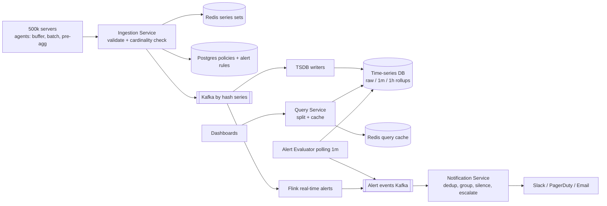

# 29 · Metrics Monitoring (Datadog-like): Study Notes

**Difficulty:** Hard · **Patterns:** Scaling Writes, Scaling Reads · **Source:** https://www.hellointerview.com/learn/system-design/problem-breakdowns/metrics-monitoring
*My own summary of the Hello Interview breakdown. Read the original for diagrams and full detail.*

## Requirements
**Functional:** ingest metrics (CPU, memory, latency, custom counters); query them and draw dashboards (filters, aggregations, time ranges); alert rules with a threshold over a window ("p99 > 500ms for 5 minutes"); notifications (email, Slack, PagerDuty).
**Out of scope:** logs, tracing, ML anomaly detection.

**Non-functional**
- **500k servers × 100 metrics every 10s = 5M metrics a second** (~1GB/s)
- Dashboard queries in seconds, even over weeks
- **Alerts within 1 minute** of the metric being emitted
- Highly available; dashboards can be eventually consistent but **alerts must be reliable**
- Handles late and out-of-order data
- **Why 1 minute is fine:** alerts usually use moving averages. Truly instant detection needs specially designed metrics, like Amazon's "milliseconds since the last order".

## Core entities (the vocabulary matters)
- **Label:** a key=value pair such as host or region.
- **Metric:** a name + labels + value at a timestamp.
- **Series:** one unique metric+labels combination tracked over time. **Series explosion (cardinality)** is the central scaling problem.
- **AlertRule:** query + threshold + duration.
- **Dashboard.**

## Data flow
1. Services emit metrics.
2. Ingest and store (write-heavy, constant).
3. Query (read-heavy, bursty during incidents).
4. Evaluate alerts periodically.
5. Notify. Steps 4–5 must be reliable above all else.

## API
- `POST /metrics/ingest {metrics[]}` (batched; protobuf in practice)
- `GET /metrics/query?query=avg(cpu{region="us-east"})&start&end&step` (a PromQL-like DSL)
- `POST /alerts/rules {name, query, for: "5m", notifications}`

## High-level design
### 1. Ingestion
- **Bad:** horizontally scale the ingestion service. The database is still hit with 5M writes a second, with no buffer and no replay.
- **Good:** **Kafka** between ingestion and storage, partitioned by a hash of metric+labels. Gives backpressure, durability and parallelism.
- **Great: an agent on each host** (Datadog Agent, OTEL collector) + Kafka.
  - The agent collects, buffers, batches and pre-aggregates locally.
  - 5M points a second become about **50k requests a second**.
- **Catch-up debt:** after an outage there's a backlog. At 50% normal utilization, 5 minutes down takes 5 minutes to catch up; at 75% it takes 15.
  - It's often **better to drop data than to run behind indefinitely**.

### 2. Storage and queries
- **Bad: Postgres.** Can't take 5M writes a second, cross-shard queries break, and DELETE-based retention causes vacuum pressure.
- **Great: a time-series database** (InfluxDB, TimescaleDB, VictoriaMetrics):
  - Append-only LSM writes.
  - Time-based chunks (dropping old data is cheap).
  - Columnar compression (~100KB → 5KB per host per day).
  - Built-in rollups.
  - **Shard by time and by hash(series).**
  - **Retention:** raw 10s data for 15 days, 1-minute rollups for 90 days, 1-hour rollups for a year.
- **A separate Query Service** (DSL → database), so reads and writes scale independently and caching is easy to add.
- This is one of the rare cases where a TSDB is the right tool. Having timestamps alone isn't a reason to use one.

### 3. Alerts
- **Don't jump to Flink.**
- Rules live in Postgres. An **Alert Evaluator** polls them every minute and runs them as queries against the TSDB, exactly like Prometheus.
- **"Alerts are just scheduled queries."**

### 4. Notifications
- A separate **Notification Service** (like Alertmanager). Never call Slack or PagerDuty directly from the evaluator.
- **Dedup:** track firing/resolved state and notify only on transitions.
- **Grouping:** collect alerts for ~30 seconds and group by cluster or service, so it's one page instead of 100.
- **Silencing** during maintenance, and **escalation** to another channel if nobody acknowledges.

## Deep dives
### 1. Fast dashboards over weeks
- **Bad: query raw data.**
  - 30 days at 10s = 259k points per series × 1000 pods ≈ 259M rows ≈ 25GB per panel.
  - That takes minutes.
- **Good: rollups at several resolutions.** Pick the resolution from the time range (30 days at 1 hour = 720 points).
  - Rollups are lossy, so **percentiles need histograms or sketches** at each level.
- **Great: caching + query splitting.**
  - Recent data (last ~2 hours) comes from the database; history comes from the cache.
  - Precompute popular dashboards.
  - Cache results by query + range; refreshes 10s apart overlap almost entirely.
  - Backfills must invalidate the cache.

### 2. Alerts faster than 1 minute
- Good: poll every 15–30 seconds. About 670 queries a second for 10k rules, which competes with dashboards.
- **Great: Flink as a second Kafka consumer.**
  - Keeps rolling windows per series in memory and turns rules into operators.
  - Fires within seconds.
  - Handle rule updates and checkpointing carefully.
  - Use it only for critical alerts; keep polling for the rest.

### 3. High availability during spikes and failures
- Bad: one instance of everything.
- Good: redundancy at every stage (load-balanced ingestion, replicated Kafka with ISR, a replicated TSDB, Flink consumer groups, notification retries).
- **Great: every step can resume.**
  - Agents buffer and retry; Kafka spans zones; **writes are idempotent**.
  - Alert state is checkpointed.
  - **Alert events go to Kafka before notifications are sent**; notifications retry and fall back to another channel.
  - Data may arrive late, but it isn't lost.
  - Add a watchdog.
- **"Who monitors the monitor?"** Never the system itself. Use a separate meta-monitor.

### 4. Cardinality explosion
- Example: `http_requests{host, region, endpoint, status, method}` could reach about 50M series.
- Hurts writes (index and memory overhead) and reads (aggregating huge numbers of series).
- **Enforce at ingestion, before publishing to Kafka:**
  - A **policy store** (Postgres): allowed label keys, a series cap, and per-label value limits for each metric.
  - A **Redis cardinality tracker** (a set of series hashes per metric).
  - **Flow:**
    1. Strip disallowed labels.
    2. Hash the labels to a series ID.
    3. Check whether the series exists.
    4. If it's new, check it against the cap.
    5. Accept, or drop and increment `dropped_metrics` (and alert).
  - A local Bloom filter as a first pass reduces Redis round trips.

## Architecture diagram (my own drawing)

## Key takeaways
- Agents + Kafka at the edge for huge write volumes.
- A TSDB with rollups.
- Alerts as scheduled queries, with Flink only where needed.
- Notifications as their own reliability-focused service.
- Cardinality is the central problem, so enforce label policies.

## Game-design hooks
- Live-ops telemetry dashboards.
- Alerting on game economy anomalies.
- Grouped and deduped notifications to players or admins.
- Limits on the number of tags per event.
