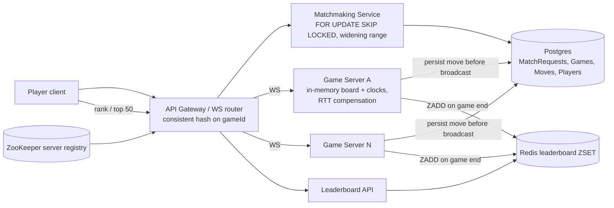

# 30 · Online Chess (Chess.com / Lichess): Study Notes ⭐ very relevant for games

**Difficulty:** Hard · **Patterns:** Dealing with Contention, Real-time Updates, Consistent Hashing · **Source:** https://www.hellointerview.com/learn/system-design/problem-breakdowns/online-chess
*My own summary of the Hello Interview breakdown. Read the original for diagrams and full detail.*

## Context
- One format only: **3-minute blitz** with no increment. Your clock runs only on your turn.
- **The server validates moves and owns both clocks.** Never trust the client.
- Ratings go up on a win and down on a loss, and drive both matchmaking and the leaderboard.

## Requirements
**Functional:** skill-based matchmaking that starts a game; real-time play; a global leaderboard and your own rank, updated shortly after games end.
**Out of scope:** spectating, chat and social, puzzles and analysis, tournaments, anti-cheat (engine detection).

**Non-functional**
- **Moves arrive in under 200ms end to end**
- **Consistency over availability for game state.** Pause the game rather than let the boards diverge: a paused game can be recovered, a corrupted one can't.
- Scale: 10M players, **500k concurrent games = 1M connections**

## Core entities
- **Player:** includes the rating.
- **Game:** colors, board, whose turn, clocks, result.
- **Move:** an append-only history, so the board can be rebuilt after a crash.
- **MatchRequest:** rating and status.

## API
- **REST:**
  - `POST /matchmaking` → requestId
  - `GET /matchmaking/:id` (polled) → status + gameId
  - `GET /leaderboard?cursor&limit`
  - `GET /players/:id/rank`
- **The rating is read on the server, never sent by the client.** Otherwise players could lie to get easier opponents.
- **WebSocket `/games/:gameId`:**
  - Client → server: `sendMove {move, moveNumber}`
  - Server → client: `gameState`, `moveAck {accepted, reason, clocks}`, `opponentMove`, `gameEnd`
  - **moveNumber** makes retries idempotent.

## High-level design
### 1. Matchmaking
- Matchmaking Service + Postgres (MatchRequests, Games).
- Create a pending request, then look for another pending one within **±200 rating**.
  - Found: create the Game and mark both matched.
  - Clients poll for the gameId.
- **Widen the range after about 30 seconds,** and eventually expire the request.

### 2. Real-time play
- The **Game Service** keeps the board and clocks **in memory** and processes moves **one at a time**.
- **Move flow:**
  1. Check it's that player's turn and the move is legal.
  2. Compute the new clocks.
  3. **Save the Move + Game update in one transaction.**
  4. Only then update memory and broadcast to both players.
  - **Persist before broadcasting,** so a crash can't erase a move someone has already seen.
- **The server also watches for flag-fall** (time running out) even if no move ever arrives.

### 3. Leaderboard
- At game end, update both ratings and the result in one transaction.
- **Top 50:** `ORDER BY rating DESC LIMIT 50` on an index is cheap.
- **Your own rank:** `COUNT(*) WHERE rating > mine` has to scan millions of rows. Earmark it.

## Deep dives
### 1. Never matching a player into two games
- **The race:** Bob and Charlie both find Alice's pending request before either marks it matched.
- **Postgres transaction:**
  1. `SELECT ... FOR UPDATE` on **my** request (stop if it's no longer pending).
  2. Find an opponent with **`FOR UPDATE SKIP LOCKED`**, so you skip anyone another transaction is claiming.
  3. Insert the Game and mark both requests matched.
  4. Commit.
  - A crash before commit rolls everything back.
  - A background task retries waiting requests and widens the range.
- **Load check:** 500k games ÷ 2 minutes ≈ 4k finish a second ≈ 8k match requests a second. Postgres is OK with indexes.
- **If it outgrows Postgres:** a **Redis ZSET pool** (score = rating) plus a **Lua script** that removes the caller, ZRANGEBYSCORE for an opponent, and removes them, atomically.
  - Then confirm in Postgres.
  - A sweeper re-adds pairs orphaned by a crash.

### 2. 500k concurrent games
- About 50k connections per server = 25k games, so ~20 servers plus headroom.
- **Both players must reach the server holding the game.**
- **Good:** route with `hash(gameId) % N`. Adding or removing a server reshuffles most games.
- **Great: consistent hashing** on gameId, with the server list in ZooKeeper (heartbeats).
  - Adding a server only moves one arc of games.
  - Affected games still have to reconnect and **recover state from the database**.
- **Great (alternative): shared state + Redis Pub/Sub.**
  - Any server can process any move.
  - A **version / move-number check** (OCC) on commit.
  - Redis caches the board with its version; a shared time source drives the clocks.
  - Pub/Sub per game delivers moves to the opponent's server; clients detect gaps from move numbers.
  - Costs more network round trips per move.
- **Author's preference: a single owner in memory,** which avoids racing on every move. Handle the complexity only when servers change.

### 3. A fair clock despite uneven latency
- **Problem:** the server charges network time to the player's clock.
  - Example: A has 30ms RTT, B has 200ms.
  - B loses about 170ms extra per move, about 7 seconds over 40 moves.
- **Bad:** a clock on the client. Modified clients cheat and clocks drift.
- **Good:** a server-owned clock with no compensation. Still unfair.
- **Great: a server-owned clock with latency compensation.**
  - Ping/pong on the WebSocket gives a **rolling median RTT**.
  - **Credit back the full median RTT** per move, because both legs are dead time for the player.
  - **Cap the credit at ~100ms**, because a client can inflate its RTT by delaying pongs.
  - B's disadvantage drops from 6.8s to 4s.
  - **Plus regional game servers** to keep RTTs small to begin with.

### 4. A fast, correct leaderboard at 10M players
- **Good: bucketed rating counts** (counts per 10-point range). Sum the buckets above you for an approximate rank. Can't be exact within your own bucket.
- **Great: a Redis sorted set.**
  - `ZREVRANK` gives an exact rank in O(log n) (add 1); `ZRANGE 0 49 REV` gives the top 50.
  - About 8k ZADDs a second and a few GB, so one instance works.
  - Ties broken by playerId.
  - **Postgres stays the source of truth;** retry the Redis update or rebuild it if it fails.

### Extra follow-ups
- **Anti-cheat:** compare moves with engine choices, check timing patterns, look for unusual accuracy.
- **Spectating:** fan out through Pub/Sub or a CDN tree. A few hundred ms of lag is fine.
- **Game archive + position search:** a separate index.
- **Premoves:** queue the move and validate it against the opponent's actual reply.

## Architecture diagram (my own drawing)

## Key takeaways
- The server is the authority for state and time.
- Persist, then broadcast.
- Move numbers make retries idempotent.
- `SKIP LOCKED` matchmaking.
- Route by game with consistent hashing.
- Compensate latency, but cap it.
- Redis ZSET for exact ranks.

## Game-design hooks (direct blueprint for a competitive game)
- Elo-style rating matchmaking with a range that widens over time.
- Turn timers with fair latency credit.
- Authoritative server validation against cheating.
- Global and seasonal leaderboards.
- Spectator mode and premoves as stretch features.
