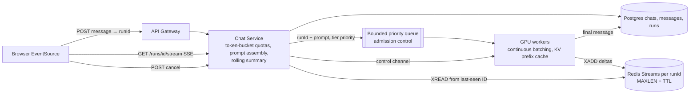

# 31 · ChatGPT (LLM Chat Serving): Study Notes

**Difficulty:** Hard · **Patterns:** Real-time Updates, Managing Long Running Tasks, Scaling Reads/cost · **Source:** https://www.hellointerview.com/learn/system-design/problem-breakdowns/chatgpt
*My own summary of the Hello Interview breakdown. Read the original for diagrams and full detail.*

## Context
- **The LLM is a black box.** The design is all about the serving system around it.
- Text only; no editing or branching of messages.

## Requirements
**Functional:** send a prompt and get a response; view past chats and resume them with earlier context included.
**Out of scope:** editing and branching, multimodal, sharing, tools and browsing, search across history.

**Non-functional**
- **Time-to-first-token (TTFT) under ~500ms.** This matters more than total generation time.
- **Fault tolerant:** an in-flight stream survives dropped connections and server failures without losing tokens
- Availability over consistency for conversation state (99.9%+)
- **Scale on limited GPUs** with fair allocation across tiers (free, Plus, Pro)
- **Scale:** about 200M daily users → ~20k prompts a second at peak → ~**120k streams in flight** at any moment.

**Out of scope:** durability of each streamed token (only the final message is saved), auth and moderation, compliance, ops.

## Core entities
- User (tier)
- Chat
- Message (role, content, token count)
- **Run**, added later: **one attempt to generate an answer**, with status queued → streaming → done, cancelled or failed, plus model and token counts.

## API
- `POST /chats` → chatId
- `POST /chats/{id}/messages {content}` → **runId** (changed from returning the full message)
- `GET /runs/{runId}/stream` (SSE; must be GET because of EventSource)
- `POST /runs/{runId}/cancel`
- `GET /chats?cursor`, `GET /chats/{id}/messages?cursor`
- userId always comes from the JWT.

## High-level design
- **Path:** Client → API Gateway → **Chat Service** (stateless, cheap) → Postgres (chats, messages) → **Inference Service** (GPU workers, expensive).
- **Key split:** the cheap chat tier and the expensive GPU tier scale separately.
- **v1 problems:**
  - Synchronous, so up to 30 seconds of blank screen.
  - No admission control.
  - Full history replayed every turn, which gets more expensive each turn and eventually exceeds the context window.

## Deep dives
### 1. Streaming tokens
- **Worker → Chat Service:** a **server-streaming gRPC** call (HTTP/2, protobuf).
- **Chat Service → browser:**
  - Bad: polling. The poll interval adds to TTFT, 400k mostly empty requests a second, and lumpy output.
  - Good: WebSocket. Works, but it's two-way and stateful when only one direction is needed.
  - **Great: SSE.** Plain HTTP, friendly to proxies, renders on the first event, and EventSource reconnects automatically.

### 2. Keeping the stream alive across reconnects and deploys
- Decouple the worker that produces tokens from the Chat Service instance that delivers them.
- **Good: Redis Pub/Sub keyed by runId**, publishing **deltas** (re-sending the cumulative text would be quadratic).
  - Fire-and-forget, so tokens published during a reconnect gap are lost.
- **Great: Redis Streams with replay.**
  - The worker `XADD`s deltas; the Chat Service does a blocking `XREAD` from the client's **last-seen ID**.
  - Reconnecting to any instance replays the gap, then continues live.
  - `MAXLEN` and a short TTL bound memory.
  - The stream is temporary working state. **The final message is written to Postgres** as the durable copy.

### 3. Routing and scheduling on GPUs
- A frontier model is split across ~8 GPUs per server; serving needs thousands of servers (tens of thousands of GPUs, billions of dollars a year). **Every percent of utilization is money.**
- **Good: a queue with pull-based workers.** Absorbs bursts. But it's unbounded, and one request per slot wastes the GPU.
- **Great: queue + continuous batching + backpressure.**
  - Each forward pass advances **many sequences by one token**. Decoding is **memory-bandwidth bound** (all the weights are streamed for every pass), so batching makes each pass of the weights pay off.
  - **Continuous:** evict finished sequences and slot in queued ones immediately (as vLLM and TGI do).
  - **Bounded queue + admission control:** shed or defer with a fast "at capacity" rather than letting the backlog grow.
  - Batches of mixed lengths are complex; the inference framework handles most of it.

### 4. Fairness and tiers
- Bad: one global rate limit. One heavy user starves everyone.
- Good: **per-user** limits (a Redis counter of concurrent runs). But it counts requests, not cost.
- **Great: cost-aware token quotas + tier priority.**
  - A token bucket per user, refilled by tier, checked in the **Chat Service** (which knows the prompt size).
  - **Debit the exact input tokens + reserve the max output**, then refund the unused part at the end. A stream is never killed mid-sentence.
  - **A tier-aware priority queue,** with a guaranteed floor for free traffic.

### 5. Cost of long conversations
- 50 turns × 500 tokens ≈ 25k input tokens per call, plus the hard context-window ceiling.
- **Good: truncate to the last N turns.** The assistant visibly forgets.
- **Great: prefix (KV) caching + a rolling summary.**
  - Reuse the KV cache for the stable prefix (system prompt + history), so only the newest turn is computed. Cuts TTFT and cost.
  - **Route each conversation to the worker where its prefix is warm.** LRU eviction means quiet chats come back cold.
  - **Rolling summary:** system prompt + summary of older turns + the last few turns verbatim + the new message.
  - **Update the summary slowly** so the cached prefix stays valid.
  - Options: retrieve only relevant older facts; cap very long chats for free users.

### Cancellation
- `POST /runs/{id}/cancel` → status cancelled → a control-channel signal → the worker drops the sequence between batches, **freeing GPU capacity**.
- **Closing the tab is not a cancel.** Generation keeps going and the user can reconnect or refetch.

### Extra follow-ups
- **Moderation:** check input and streamed output; moderate in chunks or retract afterwards.
- **Tensor vs pipeline parallelism** (NVLink, InfiniBand).
- **Speculative decoding:** a small draft model guesses tokens and the big model verifies them in one pass.
- **Model routing and semantic caching:** send simple prompts to smaller models; cache responses by embedding similarity.
- **Multimodal input and cross-chat memory** (retrieval).

## Architecture diagram (my own drawing)

## Key takeaways
- Optimize TTFT with gRPC streaming plus SSE.
- Make the Run a first-class entity.
- Redis Streams give replay across reconnects.
- Continuous batching + bounded queues for GPUs.
- Cost-aware token quotas with tier priority.
- Prefix caching + rolling summaries for long chats.

## Game-design hooks
- AI NPC or chat-companion serving: streaming dialogue with SSE.
- Per-tier token budgets for AI features (free vs premium).
- Rolling-summary memory for long-running player companions.
- A cancel button that actually frees compute.
