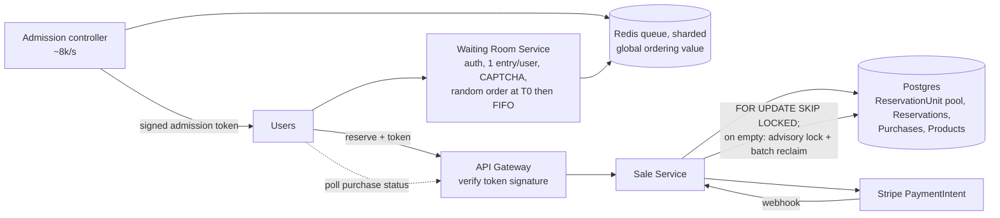

# 32 · Flash Sale System: Study Notes

**Difficulty:** Hard · **Patterns:** Dealing with Contention, Scaling Writes, Real-time Updates · **Source:** https://www.hellointerview.com/learn/system-design/problem-breakdowns/flash-sale
*My own summary of the Hello Interview breakdown. Read the original for diagrams and full detail.*

## Context
**Scenario:** Nike releases 10,000 limited shoes at noon and tens of millions of users try to buy within seconds. **Never oversell, and be fair.**

## Requirements
**Functional:** view the item; **reserve a unit for a limited time** during the sale; pay to complete the purchase.
- The **reservation step** is the one candidates most often miss.
- Payment goes through a third party and takes seconds, and you can't hold a database transaction open that long.
- The hold removes the unit right away; money is settled afterwards.

**Out of scope:** catalog and search, shipping and returns, admin tooling.

**Non-functional**
- **No overselling** under contention
- **Millions of users arriving within seconds**
- **Fair** chance at the inventory

## Core entities
Product (price, sale window, inventory), Reservation (user, product, expiresAt, status), Purchase (amount, payment status), User.

## API
- `GET /products/:id`
- `POST /products/:id/reservations` → {reservationId, productId, expiresAt} (drives the countdown)
- `POST /reservations/:id/purchases`
- `GET /purchases/:id`, polled while the webhook is pending

## High-level design
- **Path:** Client → API Gateway → **Sale Service** → Postgres.
- **Reserve, in one transaction:**
  1. Check the product is on sale and has stock.
  2. Insert a reservation expiring in 10 minutes.
  3. Decrement inventoryCount.
  - Splitting the check from the decrement allows overselling.
- **Expiry v1:** a cron job marks expired reservations and puts their units back (also in one transaction).
- **Purchase:**
  1. Check the reservation is still active.
  2. Create a PENDING Purchase.
  3. Create a Stripe PaymentIntent and return the client secret.
  4. The client pays directly with Stripe.
  5. Stripe's **webhook** marks the purchase COMPLETE and the reservation PURCHASED; on failure the reservation stays open for a retry.
- **Telling the user:** **poll** `GET /purchases/:id`. Only a few thousand reservation holders poll, so it's cheap. SSE is optional.

## Deep dives
### 1. Consistency under extreme contention
- `UPDATE ... SET inv = inv-1 WHERE id=? AND inv>0` is correct, but **every request serializes on one hot row**. Like a single checkout register.
- **Good: move it to Redis.**
  - Counter `available:{id}`, plus a ZSET `expirations:{id}` scored by expiresAt, plus the reservation data.
  - A **Lua script** does check + decrement + record atomically.
  - Downsides: **two sources of truth** (durability and reconciliation), and it's still one hot key, just faster.
- **Great: spread contention across reservation units.**
  - **One row per sellable unit** (10,000 rows).
  - Claim with `SELECT unitId ... LIMIT 1 FOR UPDATE SKIP LOCKED`, so concurrent buyers lock **different** rows in parallel.
  - Plain FOR UPDATE makes everyone queue on the same row. Under READ COMMITTED, a waiter can even get back "sold out" by mistake.
  - **Transaction:** claim a unit → none left means sold out → delete the unit → insert the Reservation → commit.
  - Shopify does this for inventory reservations.
  - **Huge inventories:** keep a **bounded, refilled pool** instead of materializing every unit.
  - Still needs admission control.

### 2. Releasing expired reservations quickly
- The cron's lag means units sit idle while users are told "sold out".
- **Good: a delayed job per reservation** (SQS delay, Temporal timer).
  - The worker checks it's still ACTIVE and expired, marks it EXPIRED and returns the unit. Idempotent.
  - Millions of jobs, and no exact timing guarantee.
- **Great: reclaim on demand.**
  - Only when the pool is **empty**: find a **batch** of ACTIVE reservations with `expiresAt <= now`, mark them EXPIRED, **keep one unit for this request**, return the rest, commit.
  - **A per-product lock** (a Postgres advisory lock) ensures only one request does the reclaiming while the others retry the normal SKIP LOCKED path.
  - No timers needed; the common path stays fast.

### 3. Millions of users at once
- The database still has a ceiling, say about 10k reservation transactions a second. No query trick fixes that, so **admission control** has to happen upstream.
- **Bad:** gateway rate limits returning 429. Clients retry in waves (thundering herd).
- **Great: a virtual waiting room.**
  - A separate **Waiting Room Service** keeps the queue in Redis (it gets much more traffic than the Sale Service). Clients poll their position.
  - The **admission controller** lets in about 8k a second (headroom below 10k).
  - Admitted users get a **short-lived signed admission token** (userId, productId, expiry).
  - **The gateway verifies the signature** with no database lookup, so nobody can skip the line.
  - The reservation flow itself doesn't change.
  - Shard the Redis queue if needed.

### 4. Fairness
- Pure FIFO rewards bots and low latency in the first few milliseconds.
- **Open the waiting room early, hold everyone until noon, then shuffle them randomly.**
  - Joining at 11:55 is no better than joining at 11:59:59.
  - Anyone arriving after noon goes to the back in FIFO order.
- **One queue entry per authenticated account,** and a **CAPTCHA** before joining.
- The signed token stops anyone skipping ahead.
- With a sharded queue, each user gets a **global ordering value** so the order stays consistent.

## Architecture diagram (my own drawing)

## Key takeaways
- Reserve-then-pay with a short hold.
- Break a hot counter into many lockable rows with SKIP LOCKED.
- Reclaim expired holds lazily, in batches, behind a lock.
- A waiting room + signed admission tokens give controlled, fair access.
- Shuffle at T0 to defeat latency races.

## Game-design hooks
- Limited-edition item drops and loot events with reservation timers.
- Lobby queues that randomize the order at launch.
- Anti-bot admission tokens.
- Countdown UI for holds.
