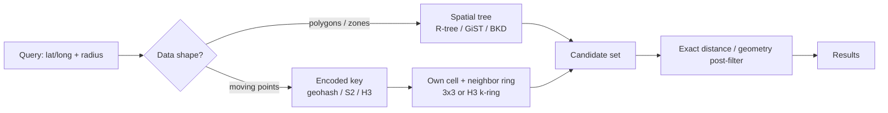

# A1 · Proximity Search: Study Notes (Advanced Topic)

**Source:** https://www.hellointerview.com/learn/system-design/deep-dives/proximity-search
*My own summary of the Hello Interview deep dive. Read the original for diagrams and full detail.*

## Why a plain index fails
- A B-tree sorts on **one dimension**, so an age range is a single seek followed by a sequential read.
- Latitude and longitude are two dimensions, and you care about straight-line distance.
  - An index on latitude gives you a horizontal strip of the earth; one on longitude gives a vertical strip.
  - A composite index still really sorts on the first column only.
  - The result is still millions of rows, so the database scans them.
- **Root cause:** a one-dimensional sort order can't keep two-dimensional neighbors next to each other.
- **The core idea:** a spatial index produces a **small candidate set**, then you **post-filter with exact distance or geometry math**.

## Two families of solutions
| Data shape | Approach | Examples |
|---|---|---|
| **Geometry** (polygons, roads, zones; containment and intersection) | Custom spatial **trees** | PostGIS (GiST/R-tree), Elasticsearch (BKD) |
| **Moving points** (drivers, live users) | **Encoded keys** on an ordinary index | Redis GEO, geohash, S2, H3 |

## Custom spatial trees
### Quadtree
- Recursively split the map into 4 quadrants until each leaf is small enough. Points live only in the leaves.
- **Search:** walk down to a leaf, then check that leaf plus its **neighboring leaves** (boundary cases).
- **Pros:** adapts to density, so Manhattan is deep and an empty lake stays one cell.
- **Cons:**
  - Splits happen at the geometric midpoint, not where the data is, so dense areas get very deep and latency depends on location.
  - **Pointer-based**, so it's bad on disk (random page reads).
- **Still great in memory:** map tiles, game collision detection.

### k-d tree → BKD tree
- **k-d:** a binary tree that **alternates splitting on x and y**, at the **median**, so each cut halves the *points*, not the area. Stays balanced at log n.
  - Example: 9 drivers bunched east and 1 straggler west. A quadtree's first cut separates only the straggler; a k-d cut splits them 5 and 5.
  - Still pointer-heavy, so still poor on disk.
- **BKD (block k-d):** points packed into **page-sized blocks**, built once from a batch, **essentially write-once**. Used by Elasticsearch geo fields.

### R-tree (R*-tree in practice)
- Built for on-disk databases and **for shapes, not just points**.
- **Minimum bounding rectangles (MBRs):**
  - Every object is wrapped in the smallest axis-aligned box that holds it (a point is a zero-size box).
  - Nearby boxes are grouped inside parent boxes, up to the root.
- **Balanced like a B-tree:** every leaf at the same depth, nodes the size of a page, splits and merges on insert and delete.
- **Rectangles can overlap,** so a query may descend several branches. R*-tree insertion heuristics keep overlap low.
- Used by **PostGIS (GiST)**, SQLite, Oracle Spatial. The default for geometry ("does this zone contain this address?").

## Encoded keys
Turn a lat/long into a sortable key or cell ID so an **ordinary B-tree or sorted set** can narrow the search. No spatial extension needed.

### Geohash
- Split the world into 32 cells (one character), split again (another character), and so on.
  - 5 characters ≈ 5km; 9 characters ≈ 5m.
- **Each character is 5 bits,** so a geohash string is also an integer. That's why Redis can store it as a 52-bit integer score.
- **A shared prefix usually means nearby,** so a proximity query is `WHERE geohash LIKE 'dr5ru%'`, a plain prefix scan.
- **Redis:** `GEOADD` stores the geohash as the ZSET score; a radius search becomes a range of scores.
- **Boundary problem:** points a meter apart can straddle a cell edge and get different prefixes.
  - **Fix, the 3×3 trick:** query your cell plus its 8 neighbors, then post-filter by exact distance.

### S2 (Google)
- Geohash treats the earth as a flat rectangle, so cells get thin near the poles.
- S2 **projects the sphere onto the 6 faces of a cube,** giving cells of roughly equal area everywhere.
- **64-bit hierarchical IDs:** truncate one to get its parent cell.
- Handles the antimeridian correctly. Used underneath **MongoDB 2dsphere**.

### H3 (Uber)
- **Hexagonal cells:** 6 neighbors, all at roughly the same distance. Squares have edge and corner neighbors at different distances.
- Clean "within k rings" queries and heat maps (dispatch, surge pricing).
- 64-bit hierarchical IDs, but **not on a space-filling curve,** so nearby IDs aren't reliably nearby on the map.
- **Dispatch pattern:**
  1. Snap each driver to a cell (~200m).
  2. Compute the rider's cell plus the surrounding ring(s).
  3. `WHERE h3_cell IN (...)` on an integer index.
  4. Post-filter by exact distance.
  - Cheap writes and cheap candidate generation.

## Choosing
- **Shapes → a spatial tree** (PostGIS). Writes are costlier: rebalancing, and BKD is write-once.
- **Moving points → encoded cells.** A driver moving is **one integer update**, which scales to millions of writes a second. You're limited to points and must always query a ring of neighbors.
- **Always post-filter.** In interviews the reasoning matters more than naming the library.

## Diagram (my own drawing)

## Related breakdowns
Yelp, Uber, Gopuff, Tinder, Strava.

## Game-design hooks
- "Nearby players or events" built on H3 rings.
- A quadtree for in-game collision and areas of interest.
- Geofenced zones (polygons) for location quests.
