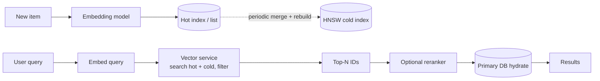

# A3 · Vector Databases: Study Notes (Advanced Topic)

**Source:** https://www.hellointerview.com/learn/system-design/deep-dives/vector-databases
*My own summary of the Hello Interview deep dive. Read the original for diagrams and full detail.*

## What it solves
- Traditional databases do exact lookups (ID = 12345).
- A vector database answers **"find things similar to this," fast.**
- Interviews mostly care about **when and how to use one**, less about the internals.

## Vectors (embeddings)
- An array of numbers representing an item. **Similar items get nearby vectors.**
- Typically 128–1536 dimensions (OpenAI large: 3072).
- **What "similar" means depends on the model:**
  - Pre-trained models (OpenAI embeddings, Sentence Transformers, BERT; CLIP or ResNet for images) give general semantic similarity.
  - **Custom-trained** models target task-specific similarity, e.g. "bought together" (diapers ↔ bottles).

## Similarity metrics
- **Euclidean (L2):** distance; depends on magnitude.
- **Cosine:** angle only. The usual choice with normalized embeddings.
- **Dot product:** unnormalized cosine; slightly faster.
- **Hamming:** differing bits in binary vectors (XOR + popcount). Used with LSH.
- In infra interviews, saying "cosine or another appropriate metric" is enough.

## KNN vs ANN
- **Exact KNN:** compare against everything, O(n). 1M × 1536 dimensions ≈ 6B FLOPs per query. SIMD and GPUs help.
- **ANN:** accept slightly approximate results for big speed gains.
  - **Recall** = the fraction of the true top-K you actually found. ~0.95 is usually fine.
- **The trade-off triangle:** **recall ↔ latency ↔ memory.**

## Index algorithms
### HNSW (the default; remember this one)
- **Like a skip list for graphs.**
  - Each vector is a node, linked to its nearest neighbors.
  - Layer 0 holds all nodes; higher layers hold progressively sparser random subsets that act as "express lanes".
- **Search:**
  1. Start at the top layer.
  2. Greedily move to the neighbor closest to the query.
  3. Drop a layer when you can't get closer.
  4. Do a thorough local search at layer 0.
- **O(log n)** with 95%+ recall.
- **Costs:** ~**2× memory** (stored edges), slow builds, expensive inserts, and graph quality degrades with many inserts.
- **Interview line:** "a multi-layer graph; greedy navigation from the sparse top down to the dense bottom; a skip list in high dimensions."

### IVF (Inverted File)
- **k-means clusters,** each with a centroid. At query time, search only the nearest **nprobe** clusters.
- Boundary effects are why you probe several clusters (there are many "edges" in 1536 dimensions).
- **Faster builds, easier inserts, less memory.** Usually lower recall at the same latency.

### LSH (Locality Sensitive Hashing)
- Hash functions designed so **similar vectors collide**. Random hyperplanes: each one contributes one bit.
- **Multiple tables** raise recall. Hash the query, gather candidates, compute exact distances.
- Fast to build and good for streaming and Hamming distance, but HNSW usually beats it.

### Annoy (Spotify)
- A **forest of random-projection trees**; search all trees and take the union of candidates (similar to random forests).
- **mmap'd index file:** shared across processes, can be larger than RAM, loads instantly.
- **Immutable:** you rebuild for changes. Good for batch-updated catalogs.

## Filtering and hybrid search
- "Similar AND in stock / in price range / published this year".
- **Post-filter:** fetch the top N ≫ K, then filter. Restrictive filters may return fewer than K.
- **Pre-filter:** filter first, then search that subset. You may lose the index.
- **Answer in interviews:** "depends on the data; I'd benchmark." For very selective filters, pre-filtering usually wins.
- **How products handle it:**
  - **pgvector:** the Postgres planner picks the vector index OR a B-tree + brute force. Either/or, not true filtered traversal.
  - **Elasticsearch kNN:** filters during HNSW traversal and guarantees K results if they exist. Native **hybrid** BM25 + vector.
  - **Pinecone:** metadata filters are first-class (inverted indexes alongside the vectors, plus a filter-effort knob).
- **Hybrid search:** keyword + vector run in parallel, then merged ("red running shoes").

## Writes and maintenance
- Optimized for reads; writes are harder.
- **Hot + cold index:**
  - Recent inserts go into a small hot index (even a brute-force list).
  - Query both and merge; periodically merge and rebuild.
  - Also useful elsewhere, e.g. a small "deleted items" list checked before returning results.
- **Updates = delete + insert,** with **soft deletes** until compaction.
- **Rebuilds take hours,** so use rolling rebuilds and swaps, partition-by-partition rebuilds, and background reindexing.
- Prefer batch updates plus periodic rebuilds when embeddings change often.

## Which product?
- **Start simple with an extension:**
  - **pgvector** (HNSW/IVF, ACID, joins with relational data; millions of vectors).
  - **Elasticsearch kNN** (if you already run ES; hybrid search).
  - **Redis Vector** (low latency).
  - **S3 Vectors.**
- **Purpose-built at roughly 100M+ vectors:**
  - Pinecone: managed, easiest to run.
  - Weaviate: open source, hybrid, GraphQL.
  - Milvus: billions of vectors, operationally complex.
  - Qdrant: Rust, strong filtering.
  - Chroma: prototyping and RAG.

## In interviews
- **Common scenarios:** semantic search, recommendations, image/video similarity, **RAG**, dedup / near-duplicates, anomaly and fraud detection.
- **Architecture patterns:**
  1. **A separate vector service** that returns IDs; hydrate them from the primary DB. **The default.**
  2. Hybrid keyword + vector with merged ranking.
  3. **Two-stage:** ANN finds the top ~1000, then a heavier reranker picks the final results.
- **Discuss:**
  - Consistency: **eventually consistent is fine.**
  - The update strategy (real-time vs batch).
  - The filtering strategy.
  - Less often: the model choice, the index type ("HNSW"), and re-embedding when the model changes. **Store the model version with each embedding.**

## Numbers to know
- float32 = 4 bytes per dimension, so **1536 dimensions ≈ 6KB per vector.**
- **1M × 1536 ≈ 6GB**, ~12GB with HNSW.
- Latency 1–5ms typical (under 10ms achievable); recall 95%+ is the target.
- Tens of thousands of QPS per node in memory.

## Gotchas
- **Not a source of truth;** it's an index.
- **Embedding drift:** a new model makes old vectors incompatible, so re-embed everything or run dual indexes.
- **Cold start** for new users in personalization.
- More dimensions means slower searches and more memory; 128 is often enough.
- Index builds take a long time (10M vectors can take an hour or more).
- **Exact match is not vector search.**

## Diagram (my own drawing)

## Related breakdowns
ChatGPT (retrieval / cross-chat memory), News Aggregator (personalization), FB Post Search, Tinder (recommendations).

## Game-design hooks
- "Players similar to you" recommendations.
- Semantic search over levels or quests.
- RAG for an in-game help bot.
- Near-duplicate detection for user-made levels.
