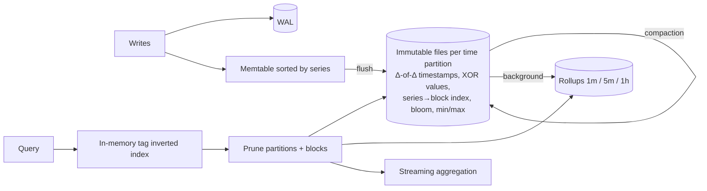

# A4 · Time Series Databases: Study Notes (Advanced Topic)

**Source:** https://www.hellointerview.com/learn/system-design/deep-dives/time-series-databases
*My own summary of the Hello Interview deep dive. Read the original for diagrams and full detail.*

## Caveat first
- **Having time-series data doesn't mean you need a TSDB.**
- Top K is the classic trap: sorting and aggregating across billions of series is exactly what TSDBs are bad at.
- Stretch Postgres or DynamoDB until you hit a real bottleneck.
- The building blocks below show up all over distributed systems.

## Motivating example
- 100k servers × 5 metrics every 10s = **50k writes a second**, 4.3B points a day.
- In plain Postgres: ~30B rows a week, slow queries, writes degrade as indexes are added.
- Each row costs 50–100 bytes because names repeat, when the real information is ~16 bytes.

## Building blocks
### 1. Append-only storage
- Never update in place; always append to the end of a file.
- Avoids random I/O: HDDs manage ~100–200 random ops a second, and SSDs also prefer sequential writes.
- Sequential writes are far faster.

### 2. LSM trees (InfluxDB, Cassandra, LevelDB)
1. **Memtable:** a sorted in-memory structure (red-black tree or skip list). Writes touch only RAM.
2. **Flush** to an immutable sorted **SSTable** when full (a fast sequential write).
3. **Background compaction** merges SSTables and drops duplicates and tombstones.
- Writes never wait for reads.
- Costs: **reads may check several SSTables**, and **write amplification** from compaction.

### 3. Delta encoding and compression
- Store **differences** between neighbors (45.2, +0.1, −0.2…) with **varints**, so small numbers take 1–2 bytes.
- **Timestamps: delta-of-delta.**
  - Regular 10s intervals give deltas of 10,10,10… and delta-of-deltas of 10,0,0,0.
  - Can reach **~1 bit per timestamp** (Facebook's Gorilla paper).
- **Floats: XOR with the previous value.** Similar numbers give mostly zero bits; store only the meaningful bits.
  - About **1.37 bytes per value** versus 8 (no need to memorize the exact figure).

### 4. Time-based partitioning
- One partition per day or week ("chunks" in TimescaleDB).
- **Writes** always go to the "now" partition.
- **Reads** skip irrelevant partitions.
- **Retention** is just **dropping old partitions** instead of expensive DELETEs.

### 5. Bloom filters per SSTable
- Each SSTable keeps a Bloom filter over its keys.
- "Definitely not here" skips the file with **zero disk I/O**.
- ~10 bits per key gives ~1% false positives, turning dozens of reads into one or two.

### 6. Downsampling and rollups
- Example policy: raw 10s for 24 hours → 1-minute averages for 7 days → 5-minute for 30 days → 1-hour for a year.
- Rollups store **min, max, sum, count**. A monthly query on 5-minute rollups reads **288× less data**.
- **Interview move (staff signal):** negotiate the requirement. "Do we really need 10s resolution for a whole year? How about fine resolution for a week, then 5-minute averages?"

### 7. Block-level metadata
- Keep the **min/max timestamp and value** per block and **prune** blocks that can't match.
- Example: a query for values > 10% skips blocks whose max is 5%.

## Data model
- **Measurement** (like a table), **tags** (indexed: host, region, service), **fields** (the actual values, not indexed), **timestamp**.
- Example: `cpu_usage,host=server-1,region=us-west value=45.2 <ts>`
- **Series** = measurement + a unique tag combination.
- **Tags are for things you filter on; fields are for values you measure.** Mixing them up causes slow queries or cardinality blow-ups.

## Storage engine
1. **WAL** for durability.
2. **In-memory buffer** organized by series.
3. **Flush** to an immutable file: compressed timestamp and value blocks, plus an **index from series to block offsets** in the footer. Two seeks per series.
4. **Compaction.**

## Query execution
1. Keep only the partitions in the time range.
2. Use the **in-memory tag index** (an **inverted index** from tag value to series) to find the series.
3. Read the buffer + files and merge.
4. **Aggregate while streaming.**

**Worked example:** `region='us-west' AND env='prod'`
- Intersect {S1,S2} ∩ {S1,S2,S3} = {S1,S2}.
- Read only blocks 0 and 1, skipping blocks 2 and 3.
- mean(45.2, 47.1, 62.3, 61.8) = **54.1**.
- Compression shrank each block from 32 bytes to ~13 (about 60% smaller).
- Postgres would fetch scattered rows instead. **Co-locating each series is the win.**

## Where it breaks: cardinality
- Number of series = unique tag combinations.
- 1,000 hosts × 50 metrics = 50k series, which is fine. Add a `user_id` tag with 10M users and you get **500B potential series**.
- The in-memory index explodes.
- **High-cardinality values (user, request ID) must be fields, not tags.**
- **Lesson:** a TSDB is 10–100× faster *only if* its assumptions hold (low-cardinality tags, regular data, small deltas). Break them and it's worse than a general-purpose database.

## Summary of patterns
Append-only, LSM, delta/XOR compression, time partitions, Bloom filters, rollups, block pruning.

## Diagram (my own drawing)

## Related breakdowns
Metrics Monitoring, Price Tracking (TimescaleDB), Strava, Ad Click Aggregator (OLAP vs TSDB), YouTube Top K (TSDB as a bad fit).

## Game-design hooks
- Player stat history charts using rollups.
- Retention by dropping old partitions.
- Delta encoding for replay and position streams (game replays compress the same way).
- Watch cardinality in game telemetry tags (don't use player_id as a tag).
