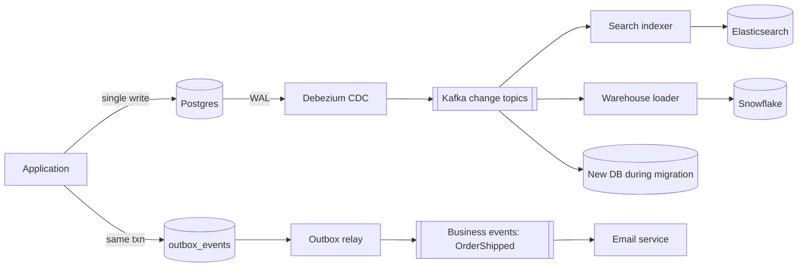

# A5 · Change Data Capture (CDC): Study Notes (Advanced Topic)

**Source:** https://www.hellointerview.com/learn/system-design/deep-dives/change-data-capture
*My own summary of the Hello Interview deep dive. Read the original for diagrams and full detail.*

## The problem
Keeping two stores in sync, e.g. Postgres (the source of truth) → Elasticsearch (search) or → a warehouse.

| Option | Problem |
|---|---|
| **Dual writes** (the app writes both) | One write succeeds and the other fails, so they drift. You need retries, idempotency and crash recovery. |
| **Polling** (cron diffs) | Repeated load on the database, plus "what changed?" bookkeeping. |
| **CDC** | Reads changes from the database's own replication log. |

## How CDC works
- Databases already write every change to an **ordered log** for crash recovery and replication: Postgres **WAL**, MySQL **binlog**.
- **A CDC connector (e.g. Debezium)** reads committed changes and publishes them to **Kafka**. Consumers apply them (e.g. update Elasticsearch).
- **The app still writes only to Postgres** and doesn't know the consumers exist, so new consumers can be added without code changes.
- **A CDC record:** `{table, operation: INSERT|UPDATE|DELETE, before, after, offset (LSN)}`. The offset lets it resume after a restart.

## When to use it (derived copies)
Three common cases:
1. **A derived index** (Postgres → Elasticsearch). A little lag is fine; if the index drifts, rebuild it.
2. **OLTP → warehouse** (Snowflake). Avoids heavy batch scans of production; captures inserts, updates **and deletes** continuously.
3. **Zero-downtime migration.**
   1. Start CDC on the old database.
   2. Backfill the new one; CDC catches the changes made during the backfill.
   3. Catch up, move reads, then move writes.
   - Beats putting dual-write migration logic in the app.

**Shared properties:**
- **The source stays authoritative.**
- **Some staleness is OK.**
- **The target can be rebuilt from the source.**

## When NOT to use it
Using CDC as a "row changed → do the next thing" trigger hides dependencies, lets backfills and repairs flood downstream services, and makes failures hard to trace.

### 1. Side effects from business events (e.g. an "order shipped" email)
- CDC knows **that** a row changed, not **why**. A migration or repair script setting status = SHIPPED looks identical to a real shipment.
- **Dedup doesn't help:** they're different log positions.
- **Fix: the transactional outbox.**
  - In the **same transaction** as `UPDATE orders`, `INSERT INTO outbox_events (event_id, 'OrderShipped', payload)`.
  - A relay publishes the outbox rows.
  - **The outbox event, with its stable event_id, is the contract,** not the orders table.

### 2. Cache invalidation
- The writer already knows which key is stale, so **invalidate it inline**, or just use a **short TTL**.
- Building a connector, topic and consumer to rediscover what the writer already knew is unnecessary.

### 3. Cleanup and background jobs (account delete, a reservation expiring after 30 minutes)
- A DELETE row doesn't say "run this job".
- Retries, backoff, timers and job state would all have to be built around an implicit row change.
- **Fix:** **enqueue a durable job**, or start a **durable workflow (Temporal)** for delayed or multi-step work.

## Rule of thumb
- **CDC = "the consumer needs a copy of my data."**
- **Outbox/events = "the consumer needs to know what happened (intent)."**
- **Job queue / workflow = "the app knows work must be done."**

## Diagram (my own drawing)

## Related breakdowns
- Yelp / Ticketmaster / Tinder (Postgres → Elasticsearch through CDC)
- News Aggregator (CDC → feed caches)
- Payment System (CDC as the audit stream)
- Price Tracking (CDC vs dual writes)
- Notification System (why the outbox wasn't needed there)

## Game-design hooks
- Keep a search or leaderboard projection in sync with the player database through CDC.
- Use an **outbox** for reward or achievement events (so a "LevelCompleted" fires exactly when it really happened, not on data repairs).
- Use durable jobs for timed rewards.
